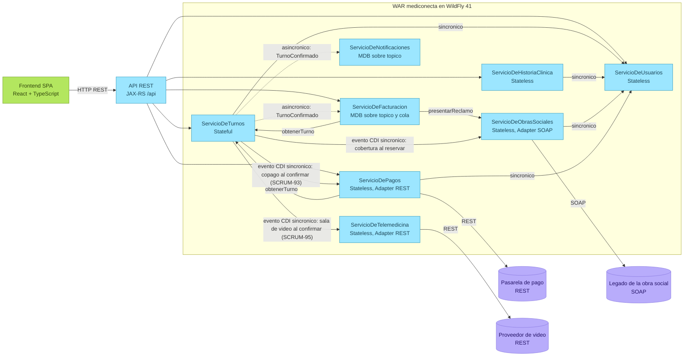
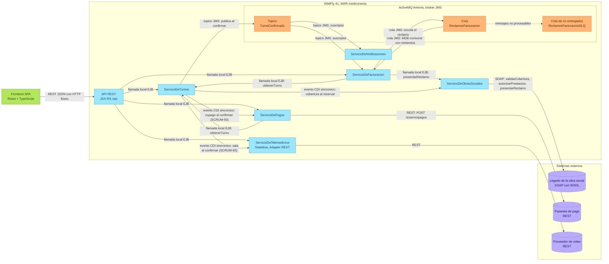
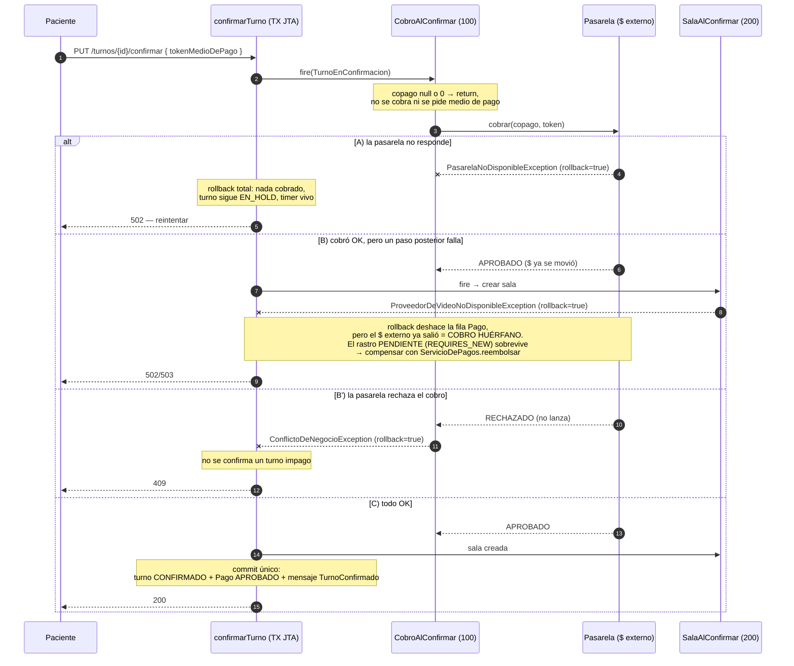

# MediConecta: diagramas de arquitectura

Versión editable en Miro: https://miro.com/app/board/uXjVEfW69Q0=/

Los dos diagramas de este archivo son la misma fuente Mermaid que está en el tablero, así que coinciden. GitHub los dibuja directamente.

**Convenciones.** Celeste: componente implementado y mergeado. Amarillo: en revisión (PR abierto). Gris: planificado. Violeta: sistema externo (simulado en el paquete `externos`). Naranja: destino JMS en Artemis. Línea continua: llamada sincrónica. Línea punteada: asincrónica (JMS) o planificada, según el rótulo.

## Arquitectura general: componentes y dependencias

Responde "quién llama a quién". Las dependencias sincrónicas son las que existen en el código: cada flecha es una llamada local a la fachada de otro componente, nunca a su DAO.

## Arquitectura de integración (SOA)

Responde "qué se conecta con qué y por qué canal". Cada conexión indica su canal: REST, SOAP, cola JMS, tópico JMS, llamada local EJB o evento CDI sincrónico. La justificación de cada elección está en la sección 4.1 del documento técnico.

## Cobro del copago al confirmar: qué pasa si la pasarela falla (SCRUM-93)

`confirmarTurno` corre en una sola transacción JTA. El observador `CobroAlConfirmar`
(prioridad `COBRO_COPAGO` = 100) cobra el copago **dentro** de esa transacción,
antes de la sala de video (`SALA_DE_VIDEO` = 200). El rollback de JTA deshace la
base y JMS, pero **no deshace un cobro REST que ya salió**: la pasarela es un
tercero por HTTP. De ahí los tres desenlaces.

**Defensa de cada caso:**

- **A — pasarela caída:** `PasarelaNoDisponibleException` es `@ApplicationException(rollback = true)`; atraviesa el `fire()`, revierte todo, el turno sigue `EN_HOLD` con su temporizador vivo y el paciente reintenta. **No se cobró nada.** Mismo patrón que la sala (sección 9.4 del documento técnico).
- **B — cobro huérfano (el caso que la consigna pide defender):** si el cobro se aprueba y después falla la sala, JTA revierte la base pero el dinero externo ya se movió. Es inevitable con un cobro REST inmediato porque el recurso externo no es transaccional. Se acota así: `ServicioDePagos` inserta el `Pago` en `PENDIENTE` con `REQUIRES_NEW` **antes** de llamar a la pasarela, así ese rastro sobrevive al rollback y permite **compensar con un reembolso** (`ServicioDePagos.reembolsar`, que ya existe).
- **B' — rechazo del cobro:** la pasarela no lanza ante un rechazo; devuelve el `Pago` en `RECHAZADO`. `CobroAlConfirmar` lo traduce a `ConflictoDeNegocioException` (409) para no dejar un turno confirmado sin pagar.
- **C — camino feliz:** una sola transacción confirma el turno, aprueba el pago y publica `TurnoConfirmado` de forma atómica.

El medio de pago (`tokenMedioDePago`) viaja en el cuerpo del `PUT /turnos/{id}/confirmar`: el paciente confirma pagando, sin necesidad de un vault de medios guardados. Un turno sin copago (cobertura total o aún sin cotizar) se confirma sin cuerpo, como antes.
