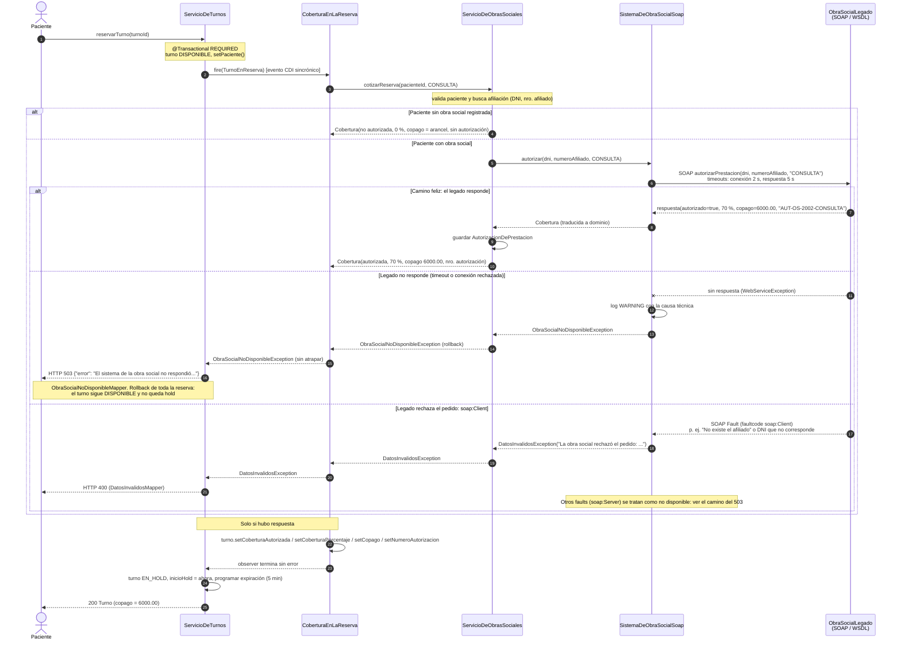

# Diagrama de secuencia: reserva de turno con cobertura de obra social

Entrega 2 (16/11). Para integrar en `docs/documento-tecnico.md` (junto a la sección 9.2).

Cubre `reservarTurno` -> `CoberturaEnLaReserva` -> `ServicioDeObrasSociales` -> `SistemaDeObraSocialSoap` -> `ObraSocialLegado` (WSDL), con el copago resultante y los dos caminos de error: legado sin respuesta (503) y `soap:Client` (400).

Ejemplo numérico: afiliado `OS-2002`, plan `PLAN_MEDIO` (70 %), prestación `CONSULTA` (arancel 20000.00). Copago = 20000 x (100 - 70) / 100 = **6000.00**.

## Notas para el documento técnico

- `CoberturaEnLaReserva` observa `TurnoEnReserva` (prioridad `PuntosDeExtension.COBERTURA`); `ServicioDeTurnos` no la conoce.
- El observer corre dentro de la transacción de la reserva (`TxType.MANDATORY`) y no atrapa nada: cualquier excepción revierte la reserva entera.
- `SistemaDeObraSocialSoap` es el único que conoce JAX-WS. Clasifica los faults por código: `Client` (SOAP 1.1) o `Sender` (1.2) -> `DatosInvalidosException`; cualquier otro fault o `WebServiceException` -> `ObraSocialNoDisponibleException`.
- Para la demo del timeout: el afiliado `OS-5005` hace que el legado demore 30 s, más que el timeout de respuesta (5 s).
- Para la demo de `soap:Client`: un número de afiliado inexistente o un DNI que no corresponde.
- El legado vive en `/mediconecta/legado/obrasocial?wsdl`. Los timeouts y la URL se pueden cambiar con las propiedades `mediconecta.obrasocial.*`.
