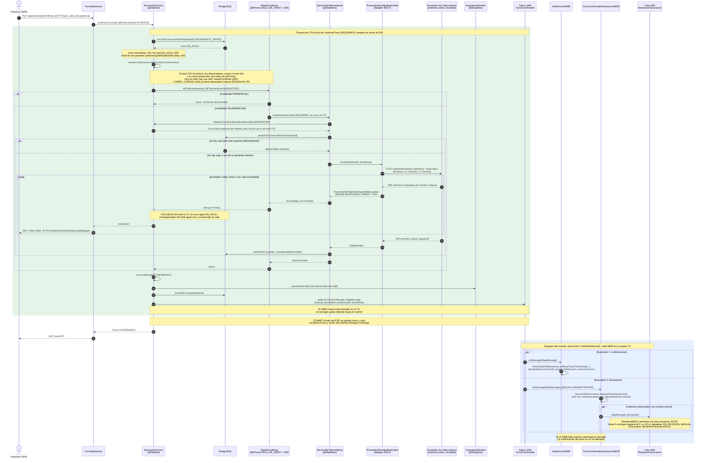

# Confirmar turno: sala de video REST y publicación de `TurnoConfirmado`

Diagrama de secuencia de `PUT /api/turnos/{id}/confirmar` tal como está en `main` (SCRUM-112). Cada participante es una clase real del código; los nombres de métodos coinciden con los del repositorio.

**Cómo leerlo.** El bloque verde es una única transacción JTA, la de `ServicioDeTurnos.confirmarTurno` (`REQUIRED`): todo lo que pasa adentro se confirma junto o se revierte junto. El bloque azul ocurre después del commit, en otros hilos y en otras transacciones: el paciente ya recibió su respuesta. Línea continua: llamada sincrónica. Línea punteada: respuesta o mensaje JMS.

## Qué pasa dentro de la transacción y qué después del commit

| Dentro de la transacción JTA de `confirmarTurno` | Después del commit (asincrónico) |
| --- | --- |
| Lock del turno con `buscarParaActualizar` y validaciones (estado `EN_HOLD`, que el hold sea del caller) | `NotificacionMDB` → `ServicioDeNotificaciones.notificarTurnoConfirmado` |
| Evento CDI `TurnoEnConfirmacion` → `SalaAlConfirmar` → `ServicioDeTelemedicina.crearSesion` → `ProveedorDeVideoRestClient` → proveedor externo | `TurnoConfirmadoFacturacionMDB` → `ServicioDeFacturacion.registrarReclamo` → cola `ReclamosFacturacion` |
| Alta o actualización de `SesionVideo` | `ReclamoMDB` presenta el reclamo por SOAP, con reintentos y DLQ |
| Turno pasa a `CONFIRMADO`, `ExpiradorDeHolds.cancelar` y `turnoDAO.actualizar` | |
| Envío del mensaje al tópico `TurnoConfirmado` (sale recién al commit) | |

## Casos a tener presentes

- **Solo hay un observador de `TurnoEnConfirmacion` en `main`.** Es `SalaAlConfirmar` (200). La cobertura (`CoberturaEnLaReserva`, `COBERTURA` = 100) observa otro evento, `TurnoEnReserva`, y corre al reservar, no al confirmar. El copago (`COBRO_COPAGO` = 100) se suma con la PR #33 (SCRUM-93), que todavía está abierta.
- **Carrera con el vencimiento del hold.** Si el timer de `ExpiradorDeHolds` vence mientras se confirma, `liberar` corre en su propia transacción (`REQUIRES_NEW`) y pide el mismo `PESSIMISTIC_WRITE` sobre el turno. Queda esperando el commit de la confirmación, después lee `CONFIRMADO` y no hace nada. El lock serializa los dos caminos.
- **Orden entre suscriptores.** Notificaciones y facturación no tienen orden entre sí ni dependen uno del otro. Cada uno es idempotente por `turnoId`, así que una reentrega no duplica la notificación ni el reclamo.

Una salvedad: la llamada HTTP al proveedor de video está adentro de la transacción en el tiempo, pero no participa de ella. Si la sala se crea y después falla algo posterior, el rollback borra la fila de `SesionVideo`, pero la sala del proveedor ya existe. No queda nadie con ese enlace y el reintento pide una sala nueva, así que el efecto es una sala huérfana sin uso. Lo mismo, con dinero, es lo que analiza la PR #33 para el cobro del copago.

## Párrafo para el documento técnico

> Texto propuesto para que Juan Pablo lo integre en `docs/documento-tecnico.md` (por ejemplo, junto a las secciones 9.1, 9.2 y 9.4). No se modificó ese documento.

La confirmación de un turno (`PUT /api/turnos/{id}/confirmar`) separa con precisión lo que tiene que ser atómico de lo que puede ser eventual. `ServicioDeTurnos.confirmarTurno` corre en una única transacción JTA: bloquea la fila del turno, valida que el hold siga vigente y sea del paciente que llama, y dispara el evento CDI sincrónico `TurnoEnConfirmacion`. Sus observadores corren en el mismo hilo y en la misma transacción, en el orden que fija `PuntosDeExtension`. Hoy el único es `SalaAlConfirmar` (prioridad 200): si el turno es de telemedicina, pide la sala a `ServicioDeTelemedicina`, que llega al proveedor de video externo por REST a través del Adapter `ProveedorDeVideoRestClient`, con timeouts cortos para no dejar la fila bloqueada. Si el proveedor no responde, la `ProveedorDeVideoNoDisponibleException` (`rollback = true`) sale por el `fire()` y revierte todo: el turno sigue `EN_HOLD`, su temporizador sigue vivo y el paciente recibe un 503 con `Retry-After` para reintentar. Si todo sale bien, el turno pasa a `CONFIRMADO`, se cancela su temporizador y se publica `TurnoConfirmado` con un `JMSContext` enlistado en la misma transacción, de modo que el mensaje solo existe si la confirmación se commiteó. A partir del commit, el tópico entrega el evento en paralelo a dos suscriptores independientes, `NotificacionMDB` y `TurnoConfirmadoFacturacionMDB`, cada uno en su propia transacción y con reentrega de Artemis ante fallas. Así, notificar al paciente o encolar el reclamo a la obra social nunca puede deshacer ni demorar una confirmación ya hecha, y `ServicioDeTurnos` no conoce a ninguno de los dos componentes. El cobro del copago (SCRUM-93) se sumará como el observador de prioridad 100, antes de la sala, sin tocar `confirmarTurno` más allá del dato del medio de pago.
