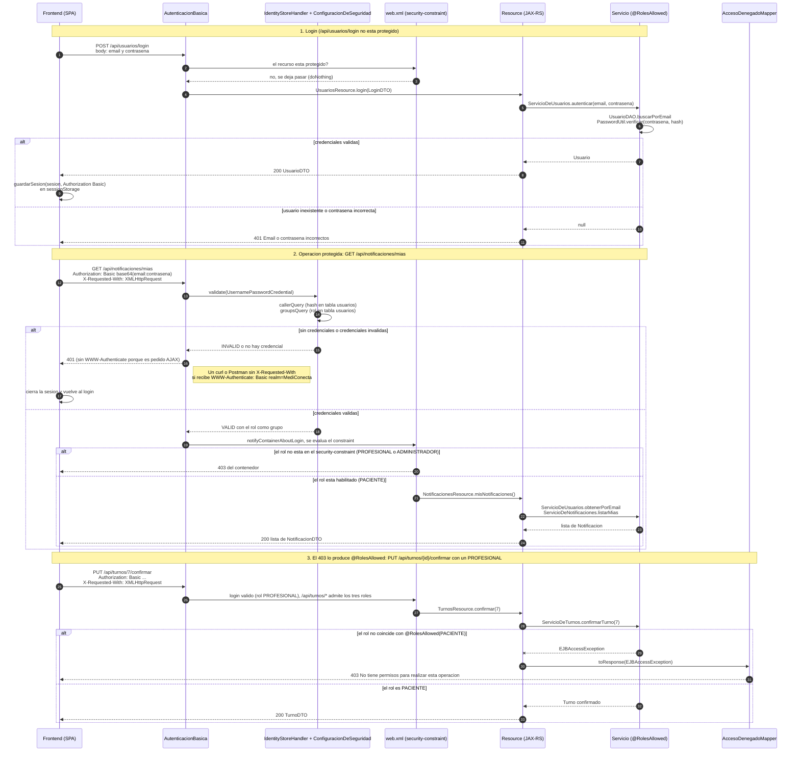

# Diagrama de secuencia: login y autorizacion por rol

El login valida email y contrasena contra la tabla `usuarios` y devuelve los datos del usuario. Desde ahi el frontend manda sus credenciales (HTTP Basic) en cada pedido, y el contenedor decide el acceso en dos capas: el `security-constraint` de `web.xml` (por URL) y `@RolesAllowed` sobre los servicios (por metodo).

Ejemplos usados: `GET /api/notificaciones/mias` (solo PACIENTE segun `web.xml`) y `PUT /api/turnos/{id}/confirmar` (`web.xml` deja pasar a cualquier rol autenticado, pero `ServicioDeTurnos.confirmarTurno` exige PACIENTE).

## Como leerlo

- **Login (pasos 1 a 8):** `UsuariosResource.login` delega en `ServicioDeUsuarios.autenticar`, que busca por email y compara con `PasswordUtil.verificar` (PBKDF2). Si algo no coincide devuelve `null` y el Resource responde 401. No hay token: el frontend guarda el encabezado `Authorization: Basic` en `sessionStorage` y lo reenvia.
- **Encabezados del frontend:** `api()` en `frontend/src/api.ts` manda siempre `X-Requested-With: XMLHttpRequest` y, si hay sesion, `Authorization`. El primero le avisa a `AutenticacionBasica` que es un pedido del SPA.
- **401 y el popup del navegador:** `AutenticacionBasica` omite `WWW-Authenticate` cuando llega `X-Requested-With: XMLHttpRequest`. Asi el navegador no muestra su popup nativo y el fetch maneja el 401. Si el recurso no esta protegido y las credenciales faltan o son invalidas, deja pasar el pedido (`doNothing`).
- **Quien valida:** `ConfiguracionDeSeguridad` declara el `DatabaseIdentityStore`: `callerQuery` trae `contrasenaHash` y `groupsQuery` trae `rol` de la tabla `usuarios`. El rol es el grupo que despues usan `web.xml` y `@RolesAllowed`.
- **Primera capa, por URL:** `web.xml` define quien entra a cada URL. `/api/notificaciones/*` solo admite PACIENTE: otro rol autenticado recibe 403 del contenedor, sin llegar al Resource.
- **Segunda capa, por metodo:** cuando el `web.xml` deja pasar a un rol pero el servicio no (por ejemplo PROFESIONAL en `confirmarTurno`), `@RolesAllowed` lanza `EJBAccessException` y `AccesoDenegadoMapper` la traduce a 403 en vez de dejar que salga como 500.
