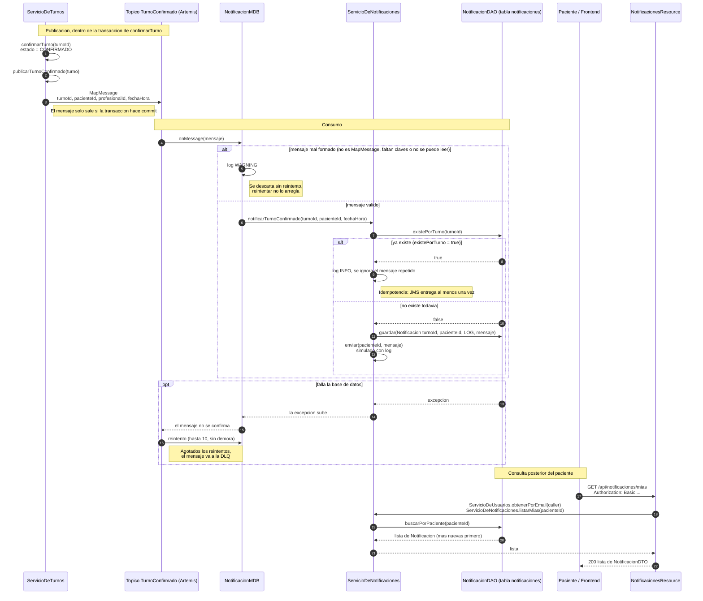

# Diagrama de secuencia: notificacion de turno confirmado

Al confirmar un turno, `ServicioDeTurnos` publica un evento en el topico JMS `TurnoConfirmado` (Artemis). `NotificacionMDB` lo consume y delega en `ServicioDeNotificaciones`, que guarda el recordatorio en la tabla `notificaciones` y lo "envia" (hoy simulado con un log). El paciente despues consulta sus notificaciones por REST.

El publicador no conoce al consumidor: solo sabe el nombre JNDI del topico (`java:/jms/topic/TurnoConfirmado`).

## Como leerlo

- **Publicacion atomica:** `publicarTurnoConfirmado` corre dentro de la misma transaccion JTA que `confirmarTurno`. Si hay rollback, el mensaje nunca sale: no se puede confirmar sin publicar ni publicar sin confirmar.
- **Formato del mensaje:** `MapMessage` con `turnoId`, `pacienteId` y `profesionalId` como long, y `fechaHora` como texto ISO-8601. El MDB solo usa `turnoId`, `pacienteId` y `fechaHora`.
- **El MDB solo traduce:** valida y lee el `MapMessage` y delega en el servicio, igual que un Resource traduce HTTP. La suscripcion al topico es no durable, porque publicador y consumidor viven en el mismo WAR.
- **Mensaje mal formado vs. falla de infraestructura:** un mensaje que no se puede leer se descarta con un WARNING. Una falla del servicio (por ejemplo la base caida) deja subir la excepcion: el contenedor no confirma el mensaje y Artemis lo reintenta hasta 10 veces, y despues lo manda a la DLQ.
- **Idempotencia:** como la entrega es "al menos una vez", `existePorTurno` evita notificar dos veces el mismo turno. El registro se guarda antes de enviar, asi una reentrega no vuelve a enviar.
- **Lectura:** `GET /api/notificaciones/mias` es solo para PACIENTE (ver `secuencia-login-roles.md`). El usuario sale del caller principal, nunca de un parametro.
