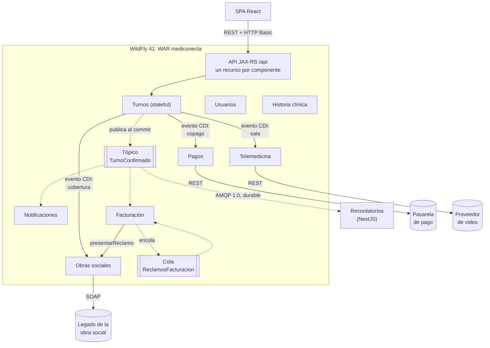
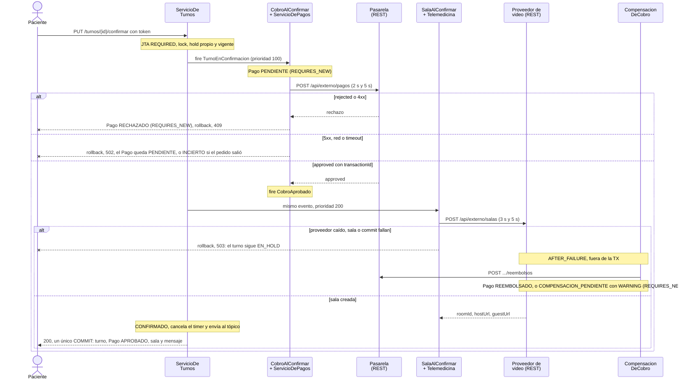
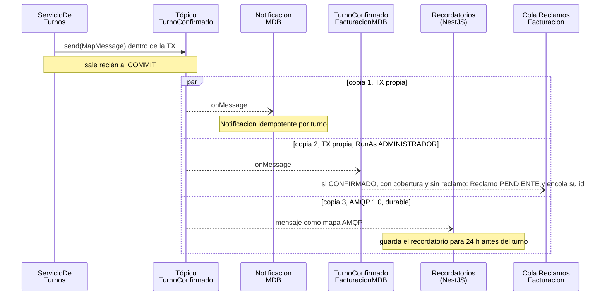
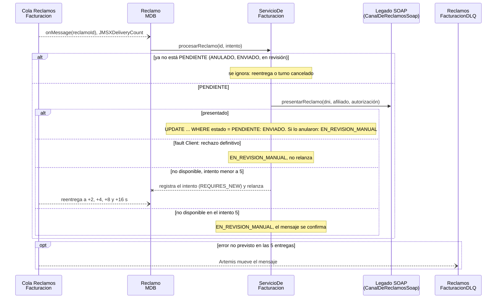

# MediConecta — Documento final consolidado

**Entrega Final: TP Integrador. Sistema completo, integrado y funcionando**

| | |
|---|---|
| Materia | Desarrollo de Aplicaciones II (3.4.218), UADE, comisión Lunes TM |
| Integrantes | Castro, Martina (1167379) · López Scala, Manuel (1165832) · Mantegazza, Juan Pablo (1152457) · Perez Ciccone, Luca (1134329) · Pereyra Metnik, Gonzalo (1075364) |
| Repositorio | https://github.com/martucastro/Mediconecta-DA2 |
| Fecha | 30/11/2026 |

Este documento consolida la arquitectura final de MediConecta: los componentes y sus interfaces, las decisiones de diseño, los patrones aplicados, la estrategia de integración, el comportamiento transaccional ante fallas, la seguridad, las pruebas, lo que aprendió el equipo y lo que queda por hacer. Los nombres de clases, destinos JMS y códigos HTTP están tomados del código. El detalle de cada pieza está en los documentos que se citan: `docs/interfaces-componentes.md`, `docs/adr/`, `docs/arquitectura.md` y `docs/documento-tecnico-entrega-2.md`.

## 1. Introducción y alcance

**Dominio.** MediConecta conecta pacientes con profesionales de la salud para gestionar turnos presenciales y de telemedicina, con cobertura de obra social, cobro del copago y facturación a la obra social. Los actores son el **paciente** (busca, reserva, confirma y cancela turnos, ve su historia y sus notificaciones), el **profesional** (abre disponibilidad, atiende y registra consultas) y el **administrador** (afiliaciones, reembolsos y reclamos). Tres terceros, simulados en el paquete `externos` y alcanzados solo por la red: el **legado de la obra social** (SOAP), la **pasarela de pago** (REST) y el **proveedor de video** (REST).

**Qué se entrega.** Ocho componentes de negocio en Jakarta EE más un noveno en Node.js; una SPA en React + TypeScript servida desde el mismo WAR (login, búsqueda, hold con copago, mis turnos, agenda del profesional, historia clínica, notificaciones y panel del administrador); el script de configuración del servidor (`deploy/mediconecta-setup.cli`), el smoke test (`deploy/smoke-test.sh`), la demo del circuit breaker (`deploy/demo-circuit-breaker.sh`), la colección de Postman (`postman/`), la prueba de carga (`load-tests/`), el guion de la demo (`docs/guion-demo-final.md`), cuatro ADR y este documento.

**Stack y por qué.** Jakarta EE 11 sobre WildFly 41 (perfil `standalone-full`), PostgreSQL, ActiveMQ Artemis embebido como broker JMS y Apache CXF para SOAP. El criterio fue cubrir de forma nativa lo que pide la cátedra: `@Stateful` y `@Stateless` gestionados por el contenedor, transacciones JTA declarativas, MDB, seguridad declarativa y JAX-WS sin infraestructura adicional. El desempate fue el componente stateful: ninguna otra opción permitida lo ofrece como parte de la especificación. SOAP es opcional en Jakarta EE desde la versión 9; es WildFly quien trae CXF listo. El componente `ServicioDeRecordatorios` está en Node.js + NestJS para el desafío de heterogeneidad (§9).

## 2. Arquitectura

### 2.1 Componentes, interfaces y diagrama

Cada componente vive en `ar.edu.uade.da2.mediconecta.<componente>` y publica una interfaz `@Local` (`<Bean>Local`) en su paquete `negocio`. Es el único contrato que conocen sus consumidores: recursos REST, MDB, observadores CDI y las fachadas de otros componentes. Como un bean con interfaz `@Local` pierde su vista sin interfaz, nadie puede saltearse el contrato. El Javadoc de cada interfaz documenta qué hace cada operación, quién la invoca, su transacción, sus roles y sus excepciones; el resumen por operación está en [`docs/interfaces-componentes.md`](interfaces-componentes.md).

| # | Componente | Bean | Interfaz y operaciones principales | Consumidores |
|---|---|---|---|---|
| 1 | Usuarios | `@Stateless` | `ServicioDeUsuariosLocal`: registrar, autenticar, consultar, listar | `UsuariosResource` y las fachadas de los demás |
| 2 | Turnos | `@Stateful` + `ExpiradorDeHolds` (`@Singleton`) | `ServicioDeTurnosLocal`: disponibilidad, reservar, confirmar, cancelar | `TurnosResource`, Pagos, Telemedicina, Facturación |
| 3 | Historia clínica | `@Stateless` | `ServicioDeHistoriaClinicaLocal`: crear, registrar consulta, listar entradas | `HistoriaClinicaResource` |
| 4 | Obras sociales | `@Stateless` | `ServicioDeObrasSocialesLocal`: cotizar la reserva, presentar reclamo, afiliaciones | `AfiliacionesResource`, `CoberturaEnLaReserva`, `CanalDeReclamosSoap` |
| 5 | Pagos | `@Stateless` | `ServicioDePagosLocal`: cobrar, consultar, reembolsar | `PagosResource`, `CobroAlConfirmar`, `ReembolsoAlCancelar` |
| 6 | Telemedicina | `@Stateless` | `ServicioDeTelemedicinaLocal`: crear sesión, obtener enlace | `TelemedicinaResource`, `SalaAlConfirmar` |
| 7 | Notificaciones | `@Stateless` + `NotificacionMDB` | `ServicioDeNotificacionesLocal`: notificar, listar las mías | `NotificacionMDB`, `NotificacionesResource` |
| 8 | Facturación | `@Stateless` + dos MDB | `ServicioDeFacturacionLocal`: registrar, procesar y anular reclamos | `TurnoConfirmadoFacturacionMDB`, `ReclamoMDB`, `ReclamoAlCancelar`, `ReclamosResource` |
| 9 | Recordatorios (Node.js) | proceso aparte | Tópico `TurnoConfirmado` (AMQP 1.0) y `GET /recordatorios` | Artemis, consulta interna |

Línea continua: llamada síncrona. Línea punteada: mensajería asincrónica. La API llama a la interfaz `*Local` de cada componente; el diagrama solo dibuja la flecha a Turnos. Además, varios componentes resuelven usuarios a través de `ServicioDeUsuariosLocal`, y Pagos, Telemedicina y Facturación leen el turno con `ServicioDeTurnosLocal` (flechas omitidas para no recargar el diagrama). Un componente usa a otro solo a través de su interfaz, nunca leyendo su tabla. La única excepción, deliberada y heredada de la Entrega N.º 1, es que `Turno` conserva dos `@ManyToOne` a `Usuario`; los componentes posteriores guardan solo ids (`Pago.turnoId`, `SesionVideo`).

### 2.2 Capas por componente

Cada componente tiene tres subpaquetes: `presentacion` (recursos JAX-RS, MDB y DTO), `negocio` (EJB, reglas, transacciones, seguridad, observadores y adaptadores) y `datos` (entidades JPA y DAO). Los `ExceptionMapper` transversales viven en el paquete raíz, y el circuit breaker, en `comun.resiliencia`.

| Componente | Presentación | Negocio | Datos |
|---|---|---|---|
| Usuarios | `UsuariosResource`, `AutenticacionBasica`, `ConfiguracionDeSeguridad` | `ServicioDeUsuarios`, `LimitadorDeIntentos` | `UsuarioDAO` |
| Turnos | `TurnosResource` | `ServicioDeTurnos`, `ExpiradorDeHolds`, `PuntosDeExtension` | `TurnoDAO` |
| Historia clínica | `HistoriaClinicaResource` | `ServicioDeHistoriaClinica`, `EntradaClinicaFactory` | `HistoriaClinicaDAO`, `EntradaClinicaDAO` |
| Obras sociales | `AfiliacionesResource` | `ServicioDeObrasSociales`, `CoberturaEnLaReserva`, `SistemaDeObraSocialSoap` | `AfiliacionDAO`, `AutorizacionDAO` |
| Pagos | `PagosResource` | `ServicioDePagos`, `CobroAlConfirmar`, `CompensacionDeCobro`, `PasarelaDePagoRestClient` | `PagoDAO` |
| Telemedicina | `TelemedicinaResource` | `ServicioDeTelemedicina`, `SalaAlConfirmar`, `ProveedorDeVideoRestClient` | `SesionVideoDAO` |
| Notificaciones | `NotificacionesResource`, `NotificacionMDB` | `ServicioDeNotificaciones` | `NotificacionDAO` |
| Facturación | `ReclamosResource`, `ReclamoMDB`, `TurnoConfirmadoFacturacionMDB` | `ServicioDeFacturacion`, `CanalDeReclamosSoap`, `ReclamoAlCancelar` | `ReclamoDAO` |
| Recordatorios | `suscriptor-turno-confirmado.ts`, `recordatorios.controller.ts` | `servicio-de-recordatorios.ts` | `repositorio-de-recordatorios.ts` (JSON) |

### 2.3 Stateful y stateless

**Stateless.** Usuarios, Historia clínica, Obras sociales, Pagos, Telemedicina, Notificaciones y Facturación son `@Stateless`: cada operación es autocontenida, no hay una conversación que recordar entre llamadas y el estado de negocio es durable en sus tablas. El pool del contenedor los reutiliza entre pedidos.

**Stateful, con honestidad.** `ServicioDeTurnos` es `@Stateful` porque turnos es el único proceso que es una conversación: reservar, y después confirmar o cancelar. El contenedor gestiona su ciclo de vida (`@PostConstruct` y `@PreDestroy` lo registran en el log). Pero el estado de la conversación **no** vive en el bean, y lo decimos ([ADR 0001](adr/0001-estado-del-hold-en-la-fila-del-turno.md)): `TurnosResource` es `@RequestScoped` e inyecta el bean, así que hay una instancia por pedido, y la que confirma no es la que reservó. El único campo propio, `turnoEnCursoId`, se escribe al reservar y **nadie lo lee**. La verdad del hold está en la fila del turno (`EN_HOLD` e `inicioHold`), para que sobreviva a un reinicio, se vea desde los pedidos de otros pacientes (el lock pesimista de la fila los serializa) y se pueda confirmar desde otra pestaña o dispositivo. La expiración vive en `ExpiradorDeHolds`, un `@Singleton`, porque la especificación no permite timers en un stateful: un temporizador no persistente por turno (5 minutos) y un barrido `@Schedule` por minuto como respaldo. **Por qué sigue siendo `@Stateful`:** la consigna pide un componente stateful, el contenedor aporta el ciclo de vida y el bean agrupa las operaciones de la conversación. Con el estado en la base, un `@Stateless` alcanzaría; es una razón de la consigna, no técnica.

## 3. Decisiones de diseño

Las cuatro decisiones de arquitectura con más consecuencias están registradas como ADR en [`docs/adr/`](adr/README.md), en formato Nygard, con las alternativas descartadas y sus costos.

| ADR | Decisión | Alternativa principal descartada, y por qué | Lo que cuesta |
|---|---|---|---|
| [0001](adr/0001-estado-del-hold-en-la-fila-del-turno.md) | El hold vive en la fila del turno; la expiración, en un `@Singleton` | El hold en la memoria del bean: invisible para los demás pedidos, perdido en un reinicio y ausente en la instancia que confirma | Un `@Stateful` que casi no usa su estado; dos mecanismos de expiración |
| [0002](adr/0002-topico-para-avisar-cola-para-el-reclamo.md) | Tópico `TurnoConfirmado` para avisar; cola `ReclamosFacturacion` para el reclamo | Procesar el reclamo en el suscriptor del tópico: la política de reentrega se configura por dirección y rige para todas las suscripciones, así que el reclamo no tendría reintentos ni DLQ propios | Consistencia eventual; cada consumidor debe ser idempotente |
| [0003](adr/0003-puntos-de-extension-con-eventos-cdi-sincronicos.md) | Los pasos que pueden vetar un turno son observadores CDI síncronos `MANDATORY` | JMS o `@ObservesAsync`: llegan después del commit y ya no pueden impedir la confirmación | El rollback no alcanza a la pasarela ni al video: cobro huérfano (§6) |
| [0004](adr/0004-adapter-para-el-legado-soap.md) | Adapter propio para el legado SOAP, con timeouts y clasificación de faults | Usar el stub SOAP desde el negocio: los tipos SOAP se filtran y cada llamador clasificaría los faults a su manera | Una capa más; el código `Client` del fault depende de CXF |

Otras decisiones, sin ADR propio: la SPA se sirve desde el mismo WAR (un origen, sin CORS) y el filtro `RutasDelFrontend` devuelve 200 en sus rutas; los componentes se referencian por id y no por entidad; todos los errores de la API responden `{"error": "..."}` en JSON (§7).

## 4. Patrones aplicados

Cada patrón resuelve un problema concreto del sistema. Ninguno está "porque sí": donde no había un problema, no se aplicó. Por ejemplo, el ticket de pagos sugería Strategy, pero `ServicioDePagos` no elige entre varias estrategias en tiempo de ejecución, así que no lo hay.

**DAO.** *Dónde:* diez DAO `@Stateless`, uno o dos por componente (`UsuarioDAO`, `TurnoDAO`, `PagoDAO`, `ReclamoDAO`…). *Problema:* separar las consultas JPA de las reglas de negocio. *Por qué:* algunos métodos de acceso tienen semántica transaccional propia que no debe mezclarse con el negocio. `TurnoDAO.buscarParaActualizar` toma el lock pesimista y relee la fila. `PagoDAO.guardarEnNuevaTransaccion` y `ReclamoDAO.registrarIntentoFallido` usan `REQUIRES_NEW`, que solo funciona porque la llamada cruza el proxy del DAO. Además, en las pruebas los DAO se reemplazan con dobles.

**Facade.** *Dónde:* las ocho interfaces `*Local` (§2.1). *Problema:* cada componente tiene varias piezas (servicio, DAO, factory, adaptadores) y otros componentes lo usan. *Por qué:* la fachada fija qué se puede invocar, con qué rol y en qué transacción. Por ejemplo, `registrarConsulta` persiste un diagnóstico y sus recetas de forma atómica; si un consumidor llamara a los DAO por separado, esa garantía se perdería.

**Adapter.** *Dónde:* tres ports con una implementación cada uno: `SistemaDeObraSocial` → `SistemaDeObraSocialSoap`, `PasarelaDePagoAdapter` → `PasarelaDePagoRestClient` y `ProveedorDeVideoAdapter` → `ProveedorDeVideoRestClient`. Facturación agrega un cuarto, `CanalDeReclamos` → `CanalDeReclamosSoap`. *Problema:* los terceros tienen otro vocabulario (`approved`, `hostUrl`, faults SOAP) y otro protocolo. *Por qué:* cada adaptador concentra la traducción al dominio y la clasificación de las fallas (rechazo frente a caída), que es justamente lo que decide entre 400, 409, 502 o 503. Fuera de `externos/obrasocial` y `obrassociales/negocio/soap`, ningún archivo importa JAX-WS.

**Factory.** *Dónde:* `EntradaClinicaFactory`. *Problema:* elegir entre `Antecedente`, `Diagnostico` y `Receta` y validar los campos obligatorios de cada tipo. *Por qué:* las validaciones son incompatibles entre sí (una receta exige medicamento, dosis y días de tratamiento; un diagnóstico, código CIE-10). Un `switch` repetido en `agregarEntrada` y `registrarConsulta` las duplicaría, y un dato inválido llegaría como 500 de la base en lugar de 400.

**Observer (eventos CDI).** *Dónde:* `ServicioDeTurnos` dispara `TurnoEnReserva`, `TurnoEnConfirmacion` y `TurnoEnCancelacion`. Los observadores viven en cada componente, ordenados por `@Priority` según `PuntosDeExtension`: cobertura (100); cobro (100) y sala (200); anulación del reclamo (100), cierre de la sala (150) y reembolso (200, último a propósito). Además, `CompensacionDeCobro` observa `CobroAprobado` con `TransactionPhase.AFTER_FAILURE`. *Problema:* cuatro componentes necesitaban intervenir en el mismo método y desarrollarse en paralelo. *Por qué:* turnos anuncia y no importa a nadie. Al ser síncronos y `MANDATORY`, una falla revierte el paso entero ([ADR 0003](adr/0003-puntos-de-extension-con-eventos-cdi-sincronicos.md)).

**Publish/Subscribe y Point-to-Point (JMS).** *Dónde:* el tópico `TurnoConfirmado` y la cola `ReclamosFacturacion` (§5). *Problema:* son dos problemas distintos: varios interesados en un mismo hecho, y un trabajo que se hace exactamente una vez, con reintentos. Por eso hay dos canales y no uno reutilizado.

**Circuit Breaker.** *Dónde:* `comun.resiliencia.CircuitBreaker`, con un circuito por sistema externo dentro de cada adaptador: `SistemaDeObraSocialSoap`, `PasarelaDePagoRestClient` y `ProveedorDeVideoRestClient`. Funciona así:

- **Estados.** Pasa de CERRADO a ABIERTO tras 3 fallas consecutivas de tipo "no disponible", queda abierto 10 s y después pasa a SEMIABIERTO: deja pasar una sola llamada de prueba, que lo cierra o lo vuelve a abrir.
- **Qué cuenta como falla.** Solo la falta de respuesta: timeout, conexión rechazada, 5xx o respuesta vacía. Un rechazo de negocio (un pago rechazado, un fault `Client`) no lo abre.
- **Configuración.** El umbral y el tiempo son propiedades de sistema (`mediconecta.<obrasocial|pasarela|video>.cb.umbral` y `.cb.abiertoMs`) que se leen en cada llamada, así que se cambian en caliente con `jboss-cli`.

*Problema:* con un tercero caído, cada pedido esperaba el timeout completo con un hilo, una transacción y la fila del turno retenidos. *Por qué:* con el circuito abierto, el adaptador falla al instante con la misma excepción "no disponible", así que los mappers y los contratos HTTP no cambian. El tiempo abierto (10 s) es menor que la ventana de reintentos de la cola de reclamos (unos 30 s): un reclamo no agota sus intentos solo porque el circuito estaba abierto. *Por qué una clase propia y no `@CircuitBreaker` de MicroProfile Fault Tolerance:* el servidor arranca con `standalone-full.xml`, que no trae ese subsistema. Habilitarlo obligaba a cambiar la configuración del servidor de cada integrante, y la clase propia se prueba sin contenedor (`CircuitBreakerTest`).

## 5. Estrategia de integración

### 5.1 Criterio síncrono o asincrónico

El canal sale de cuatro preguntas: si quien llama necesita la respuesta para decidir si el flujo sigue; cuánto acoplamiento temporal se tolera; si hay uno o varios interesados; y si el contrato lo impone un tercero. La línea divisoria: **lo que decide si el flujo sigue es síncrono y comparte la transacción del paciente; lo que reacciona a un hecho ya confirmado es asincrónico y corre en su propia transacción.**

| Integración | Canal | Modo | Por qué |
|---|---|---|---|
| Cobertura al reservar → legado | SOAP (WSDL) | Síncrono | El legado impone SOAP; el copago depende de la respuesta |
| Cobro y reembolso del copago → pasarela | REST / JSON | Síncrono | Sin cobro aprobado no hay confirmación |
| Sala de video → proveedor | REST / JSON | Síncrono | Todo turno de telemedicina confirmado tiene su enlace |
| Turno confirmado → 3 suscriptores | Tópico JMS (AMQP para Node) | Asincrónico | Hecho consumado con varios interesados independientes |
| Reclamo → legado | Cola JMS + SOAP | Asincrónico | Una vez, con reintentos y DLQ; el paciente no espera a la obra social |
| SPA → API | REST + HTTP Basic | Síncrono | Cliente propio; JSON nativo |
| Turnos → otros componentes | Evento CDI `@Observes` | Síncrono, misma transacción | Tienen que poder vetar el paso |

Las tres integraciones síncronas con terceros comparten la misma defensa:

- **timeouts explícitos;**
- **clasificación de la falla:** un rechazo (400 o 409) no se reintenta, y una caída (502 o 503) sí;
- **un circuit breaker por sistema (§4):** con el tercero caído, se deja de esperarlo.

### 5.2 SOAP: el legado de la obra social

`externos.obrasocial.ObraSocialLegado` es un endpoint JAX-WS publicado por CXF en `/mediconecta/legado/obrasocial?wsdl`, con una copia en [`docs/obrasocial.wsdl`](obrasocial.wsdl). Tiene tres operaciones: `validarCobertura`, `autorizarPrestacion` y `presentarReclamo`. Un pedido inválido devuelve el fault declarado `PedidoInvalidoException` (`@WebFault`), con faultcode `Client` y el detalle `PedidoInvalido` en `<detail>`. El Adapter `SistemaDeObraSocialSoap` crea el cliente con `Service.create` sin descargar el WSDL, usa un puerto por llamada y lo cierra en un `finally`, y fija 2 s de conexión y 5 s de respuesta (propiedades de sistema que se leen en cada llamada). Clasifica lo que vuelve en tres casos:

- Una respuesta, con o sin cobertura, se convierte en una `Cobertura`.
- Un fault `Client` es `DatosInvalidosException`, que responde 400.
- Cualquier otra falla (fault `Server`, conexión rechazada, timeout, respuesta vacía o el circuito abierto) es `ObraSocialNoDisponibleException`, que responde 503 con `Retry-After: 30` y revierte la reserva.

El afiliado de prueba OS-5005 tarda 30 s; la reserva responde 503 a los 5 s.

### 5.3 REST: pasarela de pago y proveedor de video

Los dos clientes usan Jakarta REST, con timeouts y URL leídas en cada llamada (`mediconecta.pasarela.url`, `mediconecta.video.url`).

- **Pasarela de pago.** `POST /api/externo/pagos` cobra y `POST /api/externo/pagos/{transactionId}/reembolsos` reembolsa. Los timeouts son 2 s de conexión y 5 s de respuesta.
    - Un `rejected` o un 4xx son un rechazo: el `Pago` queda `RECHAZADO` y el paciente recibe 409. Las excepciones son 408 y 429, que cuentan como caída.
    - Un 5xx, un 408 o 429, un error de red, un timeout o el circuito abierto son `PasarelaNoDisponibleException`: 502.
    - **El cobro incierto.** Si el pedido de cobro salió pero no hubo respuesta (timeout de lectura o conexión cortada), no se sabe si se cobró. El `Pago` queda `INCIERTO` (en `REQUIRES_NEW`, con un `WARNING`) y el paciente recibe 502. No hay id de transacción para reembolsar, así que el administrador no puede reembolsarlo (409) y debe conciliarlo con la pasarela.
    - Un cobro aprobado sin id de transacción se rechaza como respuesta inválida, porque no se podría reembolsar.
- **Proveedor de video.** `POST /api/externo/salas` crea la sala, con 3 s de conexión y 5 s de lectura, porque corre con la fila del turno bloqueada.
    - Un 4xx es `ConflictoDeNegocioException`: 409.
    - Un 5xx, un timeout o el circuito abierto son `ProveedorDeVideoNoDisponibleException`: 503 con `Retry-After: 30`.
    - `crearSesion` es idempotente por turno.

El diagrama muestra la confirmación de un turno de telemedicina con copago: las dos llamadas REST, la publicación en el tópico y la compensación si la transacción no llega a confirmarse.

### 5.4 Tópico `TurnoConfirmado`: tres suscriptores, dos stacks

`ServicioDeTurnos.confirmarTurno` publica un `MapMessage` (`turnoId`, `pacienteId`, `profesionalId`, `fechaHora`) con un `JMSContext` que el contenedor enlista en la transacción JTA: el mensaje sale recién en el commit, y si hay rollback no sale. `ServicioDeTurnos` no conoce a ningún suscriptor. Cada suscriptor recibe su propia copia y la procesa en su transacción. Si uno falla, Artemis reentrega a **esa suscripción**, con 10 intentos, una demora de 1 s que se duplica hasta 30 s y después la DLQ general; los demás suscriptores no se enteran.

- `NotificacionMDB` valida el mensaje y llama a `notificarTurnoConfirmado`, que es idempotente por turno. El envío está simulado con un log, y el paciente lo ve en `GET /api/notificaciones/mias`.
- `TurnoConfirmadoFacturacionMDB` (`@RunAs(ADMINISTRADOR)`, porque un MDB no tiene un usuario autenticado) llama a `registrarReclamo`. El reclamo se crea solo si el turno sigue `CONFIRMADO`, tiene cobertura autorizada y todavía no tiene reclamo. En la misma transacción se encola en `ReclamosFacturacion`.
- `ServicioDeRecordatorios` (NestJS) se suscribe por **AMQP 1.0** con `rhea`, en una suscripción **durable** autenticada con SASL PLAIN. Programa un recordatorio 24 h antes del turno y lo expone en `GET /recordatorios`.

Los dos MDB del tópico usan suscripciones **no durables**: un mensaje publicado mientras uno no está conectado se pierde para ese suscriptor (§11). Facturación es un suscriptor del tópico, y no un observador de `TurnoEnConfirmacion`, por un motivo preciso. Encolar el reclamo desde un observador no lo dejaría salir antes del commit (el `JMSContext` está enlistado), así que no habría reclamos para turnos sin confirmar. El problema real es que ese observador correría dentro de la transacción del paciente: su falla revertiría la confirmación y su trabajo la demoraría.

### 5.5 Cola `ReclamosFacturacion`: reintentos, DLQ y revisión manual

`ReclamoMDB` lee `reclamoId` y `JMSXDeliveryCount` y llama a `procesarReclamo`, que presenta el reclamo al legado por el puerto `CanalDeReclamos` (SOAP). Este puerto distingue dos fallas:

- **Rechazo definitivo** (`ReclamoRechazadoException`, de un fault `Client`): el reclamo pasa directo a `EN_REVISION_MANUAL`.
- **Falla transitoria** (`CanalDeReclamosNoDisponibleException`): el intento se registra en `REQUIRES_NEW`, para que sobreviva al rollback, y la excepción se relanza para que Artemis reentregue. La cola tiene 5 intentos, con una demora de 2 s que se duplica hasta 30 s. En el quinto, el reclamo pasa a `EN_REVISION_MANUAL` y el mensaje se confirma.

`ReclamosFacturacionDLQ` recibe solo lo que falla cinco veces por un error no previsto, como una base caída: es la red de seguridad del broker, no el camino de negocio. El administrador ve los reclamos en el panel `/admin` de la SPA.

## 6. Transacciones y comportamiento ante fallas

El flujo crítico tiene tres pasos. **Reservar** toma el lock del turno, consulta la cobertura por SOAP y deja el hold. **Retener** dura 5 minutos: el hold es durable en la fila y lo expira el contenedor. **Confirmar** cobra el copago y crea la sala por REST, cambia el turno a `CONFIRMADO` y publica en el tópico. Reservar, confirmar y cancelar son, cada uno, una transacción JTA declarativa (`@TransactionAttribute(REQUIRED)` en `ServicioDeTurnos`):

- Los observadores son `@Transactional(MANDATORY)`: solo corren dentro de la transacción del turno, y fuera de una el contenedor los rechaza.
- Los rastros que deben sobrevivir al rollback usan `REQUIRES_NEW`: el `Pago` pendiente o rechazado, el intento fallido de un reclamo y el resultado de una compensación.
- Las llamadas remotas que no persisten nada usan `NOT_SUPPORTED`: `validarCobertura` y `presentarReclamo`.
- Las excepciones de negocio son `@ApplicationException(rollback = true)`: atraviesan el `fire()` sin envolverse en `EJBException` y llegan intactas a su `ExceptionMapper`.

El evento se dispara antes de cambiar el estado. Ante cualquier falla, el turno sigue `EN_HOLD`, con su timer vivo, y el paciente puede reintentar mientras dure el hold. `confirmarTurno` verifica primero que el hold sea del caller (403, sin revelar el estado de un turno ajeno) y después el estado y el vencimiento (409). Desde el PR #72, un paciente retiene un solo hold vigente: si ya tiene otro, la reserva responde 409.

| Punto de falla | Respuesta | Estado tras el rollback | Fuera de la transacción |
|---|---|---|---|
| Legado caído (o su circuito abierto) al reservar | 503 con `Retry-After` | Turno `DISPONIBLE` | Nada |
| Hold vencido | 409 | Turno liberado por `ExpiradorDeHolds` | La autorización del legado queda emitida |
| Pago rechazado o 4xx de la pasarela | 409 | `EN_HOLD`; `Pago` `RECHAZADO` | Sin cobro |
| Pasarela caída, timeout de conexión o circuito abierto | 502 | `EN_HOLD`; `Pago` `PENDIENTE` | Sin cobro |
| Cobro enviado y sin respuesta | 502 | `EN_HOLD`; `Pago` `INCIERTO` | **Desconocido:** conciliación manual con la pasarela |
| Video caído, sala o commit fallan **después** del cobro | 503 o 500 | `EN_HOLD`, sin sala | **Compensado:** `Pago` `REEMBOLSADO`, o `COMPENSACION_PENDIENTE` |
| Falla de un suscriptor después del commit | Reentrega | `CONFIRMADO`, intacto | Nada sobre la confirmación |
| Cancelar un `CONFIRMADO` con la pasarela caída | 502 | Sigue `CONFIRMADO`, reclamo sin cambios | Sin reembolso |

**El cobro huérfano, compensado (PR #72).** El rollback JTA alcanza a PostgreSQL y al `JMSContext`, pero no a una llamada HTTP ya completada. En la Entrega N.º 2, si la pasarela aprobaba y después fallaba la sala o el commit, el dinero quedaba cobrado. Ahora la compensación funciona así:

1. `ServicioDePagos.cobrar` deja el rastro `PENDIENTE` en `REQUIRES_NEW` antes de llamar a la pasarela.
2. Si la pasarela aprueba, dispara `CobroAprobado`, que lleva ids y no la entidad.
3. `CompensacionDeCobro` lo observa con `AFTER_FAILURE`: el contenedor lo invoca solo si la transacción terminó en rollback. Fuera de la transacción, pide el reembolso y guarda el resultado con `PagoDAO.registrarCompensacion` (`REQUIRES_NEW`):
    - si el reembolso se confirma, el pago queda `REEMBOLSADO`;
    - si no, queda `COMPENSACION_PENDIENTE`, con un `WARNING`, y el administrador lo devuelve con `PUT /api/pagos/{id}/reembolso`;
    - si tampoco se puede escribir en la base, queda un `SEVERE` con los datos para conciliar a mano.

La compensación termina antes de que el paciente reciba la respuesta. Si reintenta, paga una sola vez. Como el esquema se genera con `hbm2ddl=update`, que no actualiza los `CHECK` de los enum, `ReparacionDeEsquema` los repara al arrancar, para que el estado nuevo no falle en una base existente.

**La carrera entre la cancelación y el reclamo (SCRUM-128, PR #72).** Cancelar un turno confirmado mientras su reclamo se procesa podía dejar un estado inconsistente. Ahora los cambios de estado son `UPDATE ... WHERE estado = <esperado>` y devuelven si tocaron la fila. No se toma un lock antes, porque `registrarIntentoFallido` escribe la misma fila en `REQUIRES_NEW` y se esperaría a sí mismo. Las reglas son tres:

- `procesarReclamo` marca `ENVIADO` solo si el reclamo sigue `PENDIENTE`. Si lo anularon mientras se presentaba, pasa a `EN_REVISION_MANUAL`, con el número de presentación.
- `anularReclamo` intenta, en orden: `PENDIENTE` → `ANULADO`; `ENVIADO` → `EN_REVISION_MANUAL`; y, si ya estaba en revisión, le agrega la marca "no presentar".
- Un intento fallido ya no devuelve a `PENDIENTE` un reclamo `ANULADO`.

**La cancelación, reordenada.** Para un `CONFIRMADO`, `cancelarTurno` primero marca el turno `CANCELADO` y después dispara `TurnoEnCancelacion`: se anula el reclamo, se cierra la sala y, último, se reembolsa el copago. `reembolsarCopagoDelTurno` hace `flush` antes de llamar a la pasarela, así una falla al escribir sale antes de devolver el dinero. El reembolso confirmado se guarda en `REQUIRES_NEW`. Queda un límite: si el commit falla después del reembolso, el turno vuelve a `CONFIRMADO` con el pago ya `REEMBOLSADO`, y un reintento no reembolsa dos veces.

**Demo de resiliencia (PR #60, #37 y #74).** `deploy/smoke-test.sh --resiliencia` y la carpeta `08` de Postman provocan cada falla con propiedades de sistema por `jboss-cli`, la muestran y la revierten:

- pasarela caída: 502, con el turno `EN_HOLD`;
- legado caído al reservar: 503;
- legado caído al reclamar: la confirmación da 200 y el reclamo reintenta hasta `ENVIADO`;
- video caído: 503, con el cobro compensado.

El smoke termina con el circuito de la pasarela. Tras tres cobros con la pasarela caída, una confirmación con una tarjeta válida también da 502, sin llamar a la pasarela. A los 11 s, la llamada de prueba confirma el turno. `deploy/demo-circuit-breaker.sh` hace lo mismo con el proveedor de video: con el circuito abierto, las confirmaciones de telemedicina responden 503 al instante, mientras los turnos presenciales y el resto de la API siguen respondiendo 200. En todos los casos, el resto de la plataforma sigue funcionando.

## 7. Seguridad

**Autenticación.** `ConfiguracionDeSeguridad` declara un `@DatabaseIdentityStoreDefinition` sobre el datasource. Las contraseñas se guardan con PBKDF2 y HMAC-SHA256, con salt por usuario, y el rol se publica como grupo. El mecanismo es HTTP Basic (`AutenticacionBasica`), que omite `WWW-Authenticate` en los pedidos AJAX de la SPA para evitar el popup del navegador. El login es público.

**Autorización en dos capas.** `web.xml` restringe por URL y método con `security-constraint`, y cada operación de negocio declara `@RolesAllowed`. Donde la regla depende del dato, se decide con el `SessionContext`:

- el hold es del paciente que confirma;
- el pago es del paciente o del profesional del turno;
- la historia clínica es la propia.

Un rol no permitido produce `EJBAccessException`, que se traduce en 403; sin credenciales válidas, 401.

| Operación sensible | Regla |
|---|---|
| Reservar, confirmar y cancelar un turno | PACIENTE, dueño del hold; 403 antes que 409 |
| Abrir disponibilidad, escribir la historia clínica | PROFESIONAL, con el caller como autor |
| Pagos | Paciente o profesional del turno; reembolsar, solo ADMINISTRADOR |
| Listar usuarios, registrar afiliaciones, ver reclamos | ADMINISTRADOR; un usuario consulta solo su propio id |

**Endurecimiento (PR #71, SCRUM-127 y SCRUM-132).**

- **Límite de intentos.** `LimitadorDeIntentos`: 5 fallos en 15 minutos bloquean ese email con 429. Lo comparten el login y `AutenticacionBasica`, para que la fuerza bruta no pueda usar el encabezado `Authorization` de otro endpoint.
- **Sin enumeración de cuentas.** Un email inexistente igual verifica PBKDF2 contra un hash de relleno. Los mensajes de error son genéricos, y en pagos un no administrador recibe el mismo 403 si el pago no existe o si es ajeno.
- **Email y esquema.** El email se guarda en minúsculas y las consultas normalizan el parámetro. El esquema Basic no distingue mayúsculas (RFC 7235).
- **JSON estricto.** `JsonEstricto` rechaza con 400 un número decimal donde va un entero, un desborde o un número donde va un texto.

**Formato de error.** Toda respuesta de error es `application/json` con `{"error": "..."}`, incluidos los 401 y 403 del contenedor, que antes eran HTML de Undertow y ahora pasan por `ErrorDeSeguridadServlet` (`error-page` en `web.xml`).

## 8. Calidad y pruebas

| Suite | Herramienta | Resultado observado |
|---|---|---|
| Backend: fachadas, adaptadores (con faults simulados), observadores, MDB, mappers y simuladores, sin contenedor ni red | JUnit 5 y Mockito (`mvn test`) | **450 pruebas, 0 fallas**, en 53 clases (`main` en el commit `fe06185`) |
| SPA: API, fechas, paginado, historia y reclamos | Vitest | **58 pruebas** en 6 archivos |
| `ServicioDeRecordatorios` | Jest | **27 pruebas** en 3 suites |

**Verificación en ejecución** contra WildFly 41, con una base nueva y `main` en `fe1495e` (PR #74 y la verificación de integración):

| Prueba | Resultado |
|---|---|
| `bash deploy/smoke-test.sh` | 120 correctas, 0 fallidas |
| `deploy/smoke-test.sh --resiliencia` | 140 correctas, 0 fallidas |
| `newman run` (carpetas 00–03, 05–07, 08a y 09) | 74 pedidos, 121 aserciones, 0 fallidas |
| `deploy/demo-circuit-breaker.sh` | 17 correctas, 0 fallidas |
| Recorridos de la SPA en un navegador headless | 8 de 8 |

**Integración real.** `deploy/smoke-test.sh` recorre la API desplegada. Cubre seguridad y roles, turnos y holds, SOAP, telemedicina, cobro al confirmar, mensajería (sondea, porque los MDB consumen después del commit), afiliaciones, el formato JSON de los errores y, con `--resiliencia`, las fallas controladas. La colección `postman/MediConecta-Demo.postman_collection.json` tiene 11 carpetas y 102 pedidos, del `00 - Setup` al `09 - ServicioDeObrasSociales`, con su entorno.

**Revisión.** Los PR de código del sprint final pasaron una revisión automática antes del merge (§13). Los hallazgos que no bloqueaban quedaron registrados como trabajo futuro (§11).

**Carga (PR #76).** `load-tests/reserva-turnos.js` (k6) mide el flujo disponibilidad → reservar → cancelar. El detalle, con todas las corridas, está en `load-tests/README.md`.

**Mediciones 1 y 2: sin mejora.** Se corrieron una y dos instancias en la misma máquina, sin repartir la CPU. La segunda instancia no sumó throughput: todas las corridas dieron entre 28 y 32 reservas/s. Cada pedido verifica PBKDF2, y Windows (EcoQoS) confinó las dos JVM a los 4 E-cores, así que se repartieron la misma CPU.

**Medición 3: dos nodos iguales.** Se armó un modelo de escalado horizontal en un i7-12700K:

- **Nodos:** cada WildFly fijado por afinidad a 4 P-cores propios.
- **Carga:** k6 en los E-cores.
- **Base:** un PostgreSQL compartido.
- **Corridas:** dos por configuración, de 5000 reservas cada una; se informa el promedio.

| VUs | Reservas/s (1 → 2 nodos) | Flujo p50 en ms (1 → 2) | Flujo p95 en ms (1 → 2) |
|---|---|---|---|
| 20 | 62,1 → 109,3 (+76 %) | 296 → 162 | 520 → 229 |
| 50 | 58,4 → 112,6 (+93 %) | 830 → 381 | 1074 → 690 |
| 100 | 56,3 → 105,7 (+88 %) | 1710 → 815 | 1985 → 1013 |

El componente escala porque el hold vive en la fila del turno: no hubo ningún 409. El límite es la CPU de cada nodo, por PBKDF2 en cada pedido, y no la base: PostgreSQL pasó de 0,1 a 0,4 núcleos.

El modelo tiene límites:

- los nodos comparten caché, memoria y disco, y no hay red entre ellos;
- hay una sola máquina para la base y k6;
- las corridas usaron el build `fe1495e`, anterior a #77. Por eso los errores (0 a 0,21 % de los pedidos) son todos un 500 de la carrera de `ExpiradorDeHolds.cancelar` que la prueba encontró y #77 corrigió.

En máquinas separadas, los números serían algo distintos.

## 9. Desafíos opcionales

| Desafío (§7 de la consigna) | Qué se hizo | Evidencia |
|---|---|---|
| Resiliencia ante fallas | Timeouts en los tres clientes externos; clasificación entre rechazo y caída; un circuit breaker por tercero (PR #37); reserva atómica con el legado caído; la confirmación no depende del legado (reclamo por cola); compensación del cobro huérfano | §6; `deploy/smoke-test.sh --resiliencia` (140/0); `deploy/demo-circuit-breaker.sh` (17/0); carpeta `08` de Postman |
| Heterogeneidad tecnológica | `ServicioDeRecordatorios` en Node.js + NestJS, integrado con el tópico por AMQP 1.0. Se eligió AMQP porque por STOMP el `MapMessage` llega como bytes del formato interno de Artemis | `recordatorios/README.md`; `docs/arquitectura.md`; PR #69 y #70 (verificado contra un WildFly propio: durabilidad con Node caído, reconexión tras un `reload`, clave errónea rechazada) |
| Escalabilidad horizontal | Como el hold vive en la base (ADR 0001), dos WildFly con el mismo WAR comparten PostgreSQL. Con dos nodos iguales, el throughput subió entre 76 y 93 % y la latencia bajó a la mitad | §8; `load-tests/README.md` (PR #76) |
| ADR | Cuatro ADR con alternativas y consecuencias | `docs/adr/` (PR #66) |

## 10. Aprendizajes del equipo y qué cambiaríamos

### 10.1 Aprendizajes

1. **El contenedor tiene reglas que el compilador no ve.**
    - La primera versión del hold usaba `TimerService` dentro del `@Stateful`: compilaba y devolvía 500 en la primera reserva, porque la especificación no lo permite.
    - Su `cancelar` recorría `getTimers()` sin filtrar y cancelaba los temporizadores de todos los pacientes.
    - `REQUIRES_NEW` solo tiene efecto si la llamada cruza el proxy de otro bean: por eso los rastros viven en los DAO.
2. **La atomicidad de JTA termina en la red.** Diseñamos la confirmación como una transacción única, y en la Entrega N.º 2 tuvimos que documentar como límite conocido que el cobro HTTP quedaba afuera del rollback. Aprendimos a ordenar los efectos externos al final (el reembolso tiene la prioridad 200 a propósito, y hay un `flush` antes de llamar a la pasarela) y a compensar lo que no se puede ordenar.
3. **La concurrencia aparece al ejecutar, no en las pruebas de unidad.**
    - El barrido de holds pisaba una confirmación recién confirmada: se resolvió releyendo la fila al tomar el lock.
    - La cancelación competía con el envío del reclamo: se resolvió con `UPDATE` condicionales. Un lock no servía, porque el `REQUIRES_NEW` sobre la misma fila se habría esperado a sí mismo.
4. **Los valores por defecto engañan.** Cada uno de estos casos se descubrió probando contra el servidor real:
    - `hbm2ddl=update` no actualiza los `CHECK` de un enum.
    - Yasson convierte `1.5` en `1` y `"5"` en `5`.
    - Un cliente SOAP o REST sin timeouts explícitos retiene el hilo, la transacción y la fila del turno mientras el tercero no conteste.
    - STOMP no traduce un `MapMessage`.
5. **La documentación también se verifica contra el código.** Al redactar los ADR encontramos afirmaciones incorrectas en los documentos anteriores, que este documento ya no repite:
    - que un reintento del tópico les llegaría a todos los suscriptores, cuando Artemis reentrega por suscripción;
    - que un observador podía encolar un reclamo para un turno sin confirmar, cuando el `JMSContext` está enlistado;
    - que el bean stateful usaba su estado, cuando `turnoEnCursoId` nunca se lee.
6. **Integrar temprano es más barato.** Cinco PR del equipo llegaron a estar hasta 108 commits detrás de `main`. Rescatarlos exigió varios merges y resolver conflictos en `web.xml`, `App.tsx` y el smoke test. La lección: PR chicos, mergeados seguido.

### 10.2 La decisión de arquitectura que cambiaríamos

**Cobrar el copago con una sola llamada dentro de la transacción de la confirmación.** Lo decidimos así (ADR 0003) para que un rechazo vetara la confirmación en el mismo pedido, y para la base y JMS funciona. Pero el cobro es un efecto externo que el rollback no deshace. Cerrar ese hueco costó un observador `AFTER_FAILURE`, un estado nuevo (`COMPENSACION_PENDIENTE`), rastros en `REQUIRES_NEW`, la reparación del esquema y reordenar la cancelación: un PR de 33 archivos y unas 1.700 líneas agregadas (#72). Y todavía queda un caso límite en la cancelación.

Si empezáramos de nuevo, diseñaríamos el pago en dos fases desde el principio:

- en la confirmación, **preautorizar** el copago;
- **capturarlo** con un observador `AFTER_SUCCESS`, ya con el commit hecho;
- si la captura falla, reintentarla por una cola, como el reclamo.

Así el efecto externo irreversible ocurre solo después del commit, y la peor falla es una preautorización que vence sola, no dinero que hay que devolver. El costo: la pasarela simulada necesitaría dos operaciones, y la captura, sus propios reintentos.

**Lo que no cambiaríamos:** el hold en la fila del turno (ADR 0001). Es lo que hoy permite escalar a dos instancias y sobrevivir a un reinicio.

## 11. Trabajo futuro

Estos son los límites conocidos, todos documentados en el código, en los ADR o en los PR:

- **Temporizadores por instancia (ADR 0001).** El timer de un hold vive en la JVM que lo creó. Con un balanceador round-robin, la cancelación puede caer en la otra instancia, y el timer viejo sigue vivo: puede liberar antes de tiempo un hold nuevo del mismo turno. Solución: guardar `inicioHold` en el `info` del timer y compararlo al vencer. El estado del circuit breaker también es por instancia.
- **PBKDF2 en cada pedido.** No hay sesión ni token: cada pedido con Basic verifica la contraseña con PBKDF2 de 120.000 iteraciones. Es el límite de escala que midió k6. Pagarlo solo en el login, con una sesión o un token, bajaría el costo por pedido.
- **Sin clave de idempotencia hacia la pasarela.** Un pago `INCIERTO` se concilia a mano, y un reintento del paciente hace un cobro nuevo aunque el anterior se haya hecho. Una clave por intento de cobro lo resolvería.
- **Mensajería por instancia.** Artemis está embebido en cada WildFly, así que con dos instancias las colas y el tópico no se comparten. Haría falta un broker externo o un clúster.
- **Suscripciones no durables.** Los dos MDB del tópico pierden lo publicado durante un redespliegue. Solución: declarar `subscriptionDurability`. Recordatorios ya es durable.
- **Recordatorios de turnos cancelados.** No existe un evento `TurnoCancelado`, así que un recordatorio se envía aunque el turno se haya cancelado. Además, `registrar` devuelve la primera coincidencia, la API de Node no tiene autenticación (escucha solo en `127.0.0.1`) y los dos stacks dependen de la misma zona horaria.
- **Limitador de login en memoria.** Es por instancia, se pierde al reiniciar y tiene un tope de 10.000 emails. Con varios nodos debería vivir en la base o en una caché compartida.
- **Dos holds simultáneos.** El lock es del turno y no del paciente: dos reservas concurrentes del mismo paciente todavía pueden pasar las dos.
- **Sin `UNIQUE` en `usuarios.email`.** La unicidad del email la verifica `registrarUsuario` antes de insertar, así que dos registros simultáneos con el mismo email podrían pasar los dos.
- **Sala cancelada.** Después de cancelar un turno de telemedicina, `GET /api/telemedicina/turno/{turnoId}` responde 404, igual que un turno sin sala: no distingue la sala cancelada.
- **Canal real de notificación.** Las notificaciones y los recordatorios se "envían" con un log. Falta un canal de email o SMS.
- **Cancelación con el commit fallido.** Si el commit falla después del reembolso, el turno queda `CONFIRMADO` con el pago `REEMBOLSADO`.
- **Efectos externos sin compensar.** Quedan la sala creada en el proveedor cuando falla un paso posterior y la autorización del legado cuando el hold vence. El legado no tiene operación de anulación.
- **Configuración duplicada.** `ServicioDeFacturacion.MAX_INTENTOS` y `max-delivery-attempts` tienen que coincidir a mano.

## 12. Participación del equipo

`git shortlog -sn --no-merges` sobre `main` cuenta 232 commits sin merges entre el 07/09 y el 17/11. Algunos integrantes aparecen con dos identidades de git, que se suman:

| Integrante | Identidades de git | Commits |
|---|---|---|
| Mantegazza, Juan Pablo | "Juan Pablo Mantegazza" (118) y "Juampiman" (41) | 159 |
| Castro, Martina | "martucastro" | 28 |
| López Scala, Manuel | "Manu" | 19 |
| Perez Ciccone, Luca | "Luca Perez Ciccone" | 16 |
| Pereyra Metnik, Gonzalo | "Gonzalo Pereyra Metnik" | 10 |

El conteo no mide toda la participación. Los PR de Martina (#38 y #40), de Gonzalo (#34) y el circuit breaker de Manuel (#37) se pusieron al día con `main` sin reescribir su historia, y el otro de Manuel (#60) se integró tal cual: todos conservan su autoría. Además, 108 de los commits de "Juan Pablo Mantegazza" son del 15 al 17/11: corresponden a la auditoría de la Entrega N.º 2 y al sprint final, hechos con Claude Code desde su sesión (§13).

## 13. Declaración de uso de inteligencia artificial generativa

Según lo pide la cátedra, declaramos el uso de **Claude Code** (Anthropic), un asistente de programación basado en modelos de lenguaje, durante todo el proyecto.

- **Durante el cuatrimestre.** Se usó para redactar y consolidar la documentación, contrastándola con el código; para revisar código y detectar inconsistencias entre la documentación y la implementación; y para generar código repetitivo (DTO, pruebas de unidad y scripts de verificación).
- **Entrega N.º 2 (15 y 16/11).** Se usó para auditar la plataforma con pruebas contra la aplicación desplegada y para implementar las correcciones, integradas en los PR #50 a #59.
- **Sprint final (desde el 17/11).** El uso fue intensivo y con orquestación de varios agentes. Una sesión coordinadora repartía tareas acotadas a agentes que trabajaban en copias aisladas del repositorio (git worktrees) y se usó para:
    - **implementar los PR #66 a #72 y #74 a #77:**
        - los ADR, las interfaces `*Local` y la presentación de obras sociales;
        - el panel del administrador;
        - el componente NestJS y su corrección de persistencia;
        - el endurecimiento de seguridad y la compensación del cobro huérfano;
        - el smoke final, el detalle del fault SOAP, la prueba de carga y la carrera del expirador;
    - **rescatar los PR del equipo** (#34, #38, #40 y #37), mergeando `main` en sus ramas sin reescribir su historia y, en el caso de #37, llevando el circuit breaker a los adaptadores actuales;
    - **correr las verificaciones:** el smoke, newman, la demo del circuit breaker y las mediciones de k6;
    - **revisar automáticamente cada PR** antes del merge, con cuatro enfoques: riesgo, resiliencia, legibilidad y confiabilidad;
    - **redactar este documento**, verificado contra el código.

El equipo fijó el alcance y las prioridades, revisó e integró cada cambio, y cada PR incluye sus pruebas automatizadas. Las decisiones de arquitectura (el stack, los componentes, el criterio síncrono o asincrónico y las registradas en los ADR) son del equipo y se tomaron durante el cuatrimestre. Cada integrante debe poder explicar y defender individualmente cualquier parte del código o del diseño, incluido lo producido con asistencia de IA.
