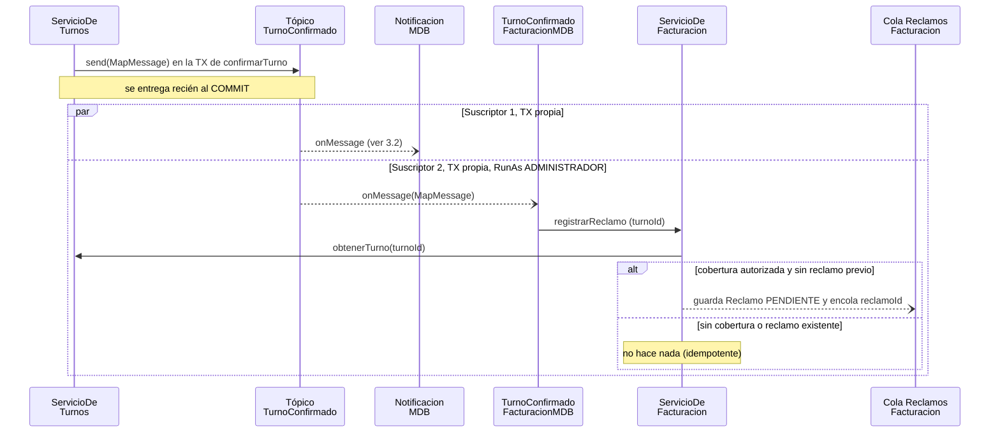
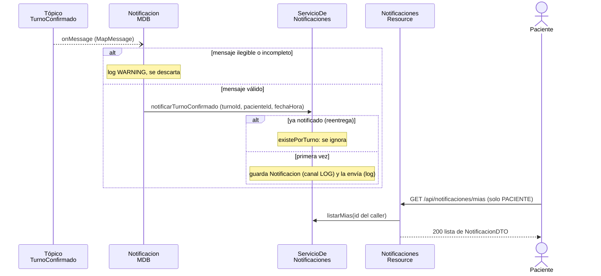
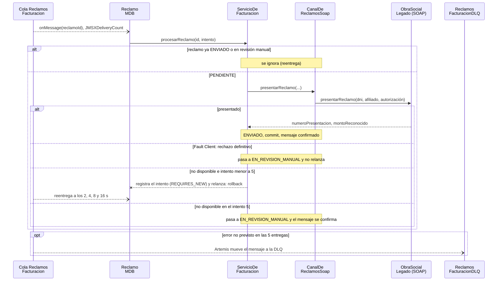
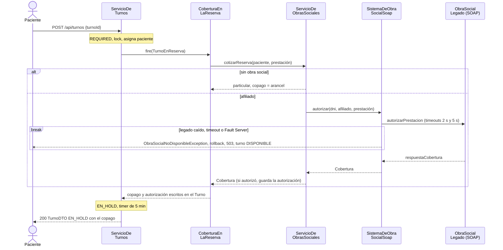
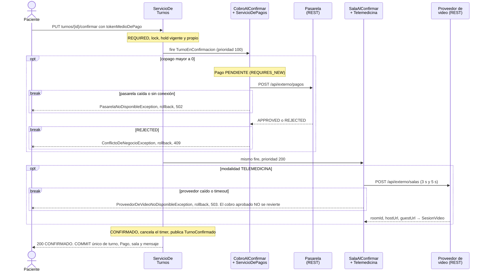
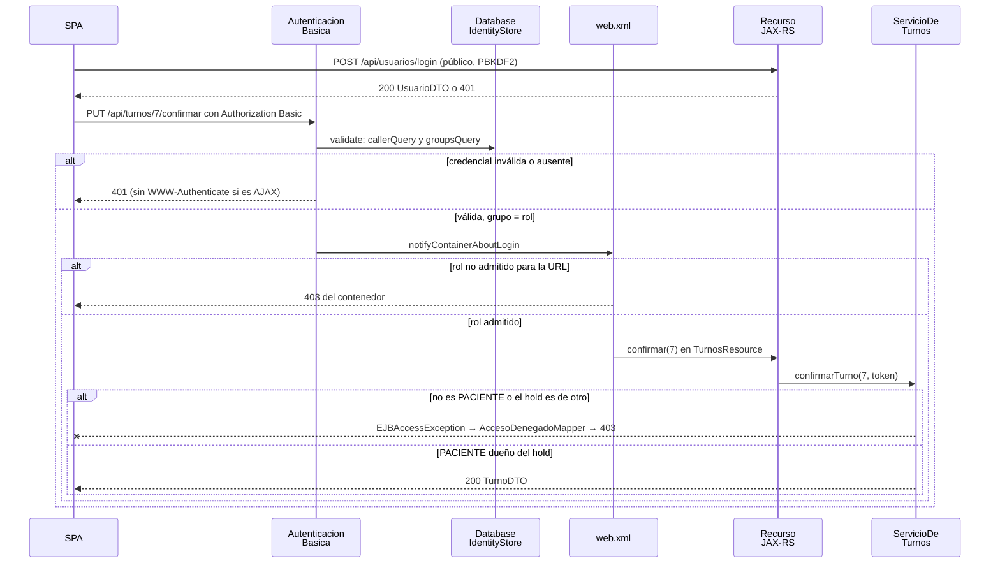

# MediConecta — Documento técnico

**Entrega Obligatoria N.º 2: sistema integrado con mensajería asincrónica y servicios web SOAP y REST**

| | |
|---|---|
| Materia | Desarrollo de Aplicaciones II (3.4.218), UADE, comisión Lunes TM |
| Integrantes | Castro, Martina (1167379) · López Scala, Manuel (1165832) · Mantegazza, Juan Pablo (1152457) · Perez Ciccone, Luca (1134329) · Pereyra Metnik, Gonzalo (1075364) |
| Repositorio | https://github.com/martucastro/Mediconecta-DA2 |
| Fecha | 16/11/2026 |

Este documento describe el sistema integrado tal como está en el repositorio: qué se integra con qué, por qué cada integración es síncrona o asincrónica, cómo se comporta el flujo transaccional crítico ante una falla a mitad de camino y un diagrama de secuencia por integración. El detalle de diseño de cada componente (Entrega N.º 1) sigue en `docs/documento-tecnico.md`. Los nombres de clases, métodos, destinos JMS y códigos HTTP están tomados del código.

## 1. Arquitectura y componentes

**Stack.** Jakarta EE 11 sobre WildFly 41, PostgreSQL 18, ActiveMQ Artemis embebido en WildFly como broker JMS, Apache CXF (JAX-WS) para SOAP y una SPA en React + TypeScript servida desde el mismo WAR. El criterio fue cubrir de forma nativa lo que pide la cátedra: un `@Stateful` cuyo ciclo de vida gestiona el contenedor, transacciones JTA declarativas, MDB sobre JMS y JAX-WS sin infraestructura adicional.

**Capas.** Cada componente vive en `ar.edu.uade.da2.mediconecta.<componente>` con tres subpaquetes: `presentacion` (recursos JAX-RS, MDB y DTO), `negocio` (EJB, reglas, transacciones, seguridad y adaptadores) y `datos` (entidades JPA y DAO). Un componente usa a otro solo a través de su fachada, nunca leyendo su tabla. Los tres terceros simulados (legado de la obra social, pasarela de pago y proveedor de video) están en el paquete `externos` y se alcanzan exclusivamente por la red, por SOAP o por HTTP, igual que si fueran sistemas reales: ninguna clase de negocio los importa.

| # | Componente | Tipo | Interfaz | Capas | Patrones |
|---|---|---|---|---|---|
| 1 | `ServicioDeUsuarios` | `@Stateless` | `/api/usuarios`, login | P · N · D | Facade, DAO |
| 2 | `ServicioDeTurnos` | `@Stateful` + `ExpiradorDeHolds` (`@Singleton` con `TimerService`) | `/api/turnos` | P · N · D | Observer (sujeto), DAO |
| 3 | `ServicioDeHistoriaClinica` | `@Stateless` | `ServicioDeHistoriaClinicaLocal`, `/api/historias` | P · N · D | Facade, Factory, DAO |
| 4 | `ServicioDeObrasSociales` | `@Stateless` | fachada local (sin recurso HTTP) | N · D | Adapter (SOAP), Observer |
| 5 | `ServicioDePagos` | `@Stateless` | `ServicioDePagosLocal`, `/api/pagos` | P · N · D | Facade, Adapter (REST), Observer |
| 6 | `ServicioDeTelemedicina` | `@Stateless` | `/api/telemedicina` | P · N · D | Facade, Adapter (REST), Observer |
| 7 | `ServicioDeNotificaciones` | `@Stateless` + `NotificacionMDB` | tópico `TurnoConfirmado`, `/api/notificaciones/mias` | P · N · D | Publish/Subscribe |
| 8 | `ServicioDeFacturacion` | `@Stateless` + dos MDB | tópico, cola `ReclamosFacturacion`, `/api/reclamos` | P · N · D | Pub/Sub, Point-to-Point, Adapter |

`ServicioDeTurnos` es el componente con estado conversacional: sostiene el hold del turno entre reservar y confirmar, y registra su ciclo de vida con `@PostConstruct` y `@PreDestroy`. La fuente de verdad del hold es la fila del turno (`EN_HOLD` e `inicioHold`), para que sobreviva a un reinicio y se pueda confirmar desde otra petición. La expiración vive en `ExpiradorDeHolds`, un `@Singleton`, porque la especificación no permite timers sobre un bean stateful: un timer por turno (5 minutos) y un barrido `@Schedule` por minuto como respaldo.

Los componentes que reaccionan a un paso del turno se enganchan con eventos CDI síncronos (`TurnoEnReserva`, `TurnoEnConfirmacion`) ordenados por `PuntosDeExtension`: `ServicioDeTurnos` dispara el evento sin importar a obras sociales, pagos ni telemedicina.

## 2. Mapa de integraciones y criterio síncrono o asincrónico

El canal de cada integración surge de cuatro preguntas: si quien llama necesita la respuesta para decidir si el flujo sigue (síncrono) o solo avisa algo que ya pasó (asincrónico); cuánto acoplamiento temporal se tolera con el otro sistema; si hay un interesado o varios en el mismo evento (cola o tópico); y si el contrato lo impone el tercero (legado SOAP) o es un partner moderno con API REST.

| Integración | Origen → destino | Canal | Modo | Justificación |
|---|---|---|---|---|
| Cobertura al reservar | `ServicioDeObrasSociales` → legado de la obra social | SOAP (JAX-WS, WSDL) | Síncrono | El legado impone su contrato SOAP. El paciente necesita conocer cobertura y copago antes de confirmar: la respuesta decide la reserva. |
| Cobro del copago | `ServicioDePagos` → pasarela de pago | REST / JSON | Síncrono | Partner moderno con API REST propia. Sin cobro aprobado no se confirma: la respuesta decide la confirmación. |
| Sala de video | `ServicioDeTelemedicina` → proveedor de video | REST / JSON | Síncrono | Partner moderno. Invariante: todo turno de telemedicina confirmado tiene su enlace. |
| Turno confirmado | `ServicioDeTurnos` → tópico `TurnoConfirmado` | JMS, publicación/suscripción | Asincrónico | Hecho consumado con varios interesados independientes. El publicador no espera ni conoce a los consumidores. |
| Notificación al paciente | tópico → `NotificacionMDB` | JMS, suscriptor | Asincrónico | Reacción posterior: no puede demorar ni deshacer la confirmación. |
| Reclamo a la obra social | `ServicioDeFacturacion` → cola `ReclamosFacturacion` → legado | JMS punto a punto + SOAP | Asincrónico | Trabajo que se hace exactamente una vez, con reintentos y DLQ. El paciente no espera a la obra social ni lo afecta su caída. |
| SPA ↔ API | navegador → `/api/*` | REST / JSON + HTTP Basic | Síncrono | Único cliente, propio y JSON nativo; SOAP no aporta nada sin un tercero que lo imponga. |
| Puntos de extensión | `ServicioDeTurnos` → observadores | Evento CDI `@Observes` | Síncrono, misma transacción | Los pasos que deciden si el turno se confirma tienen que poder revertirlo; `@ObservesAsync` correría fuera de la transacción. |

La línea divisoria es simple: lo que decide si el flujo sigue es síncrono y participa (en el tiempo) de la transacción del paciente; lo que reacciona a un hecho ya confirmado es asincrónico y corre en su propia transacción. Entre tópico y cola, la diferencia es uno-a-muchos frente a exactamente-una-vez: el tópico entrega una copia a cada suscriptor, y la cola garantiza un único consumidor con su propia política de reintentos, sin que un reintento le llegue a quien no falló.

## 3. Mensajería asincrónica

Los destinos se crean con `deploy/mediconecta-setup.cli`. Los dos productores inyectan un `JMSContext` que el contenedor enlista en la transacción JTA en curso, así que un mensaje sale del broker recién cuando esa transacción hace commit; si hay rollback, nunca sale.

| Destino (JNDI) | Tipo | Productor | Consumidores | Política de reentrega |
|---|---|---|---|---|
| `java:/jms/topic/TurnoConfirmado` | Tópico | `ServicioDeTurnos.confirmarTurno` | `NotificacionMDB`, `TurnoConfirmadoFacturacionMDB` (suscripciones no durables) | La del servidor por defecto (observada: 10 entregas sin demora y luego la DLQ general) |
| `java:/jms/queue/ReclamosFacturacion` | Cola | `ServicioDeFacturacion.registrarReclamo` | `ReclamoMDB` | `max-delivery-attempts=5`, demora 2 s con multiplicador 2 (máximo 30 s), `dead-letter-address` → `ReclamosFacturacionDLQ` |

### 3.1 Proceso 1, tópico `TurnoConfirmado`

Al confirmar, `ServicioDeTurnos` publica un `MapMessage` con `turnoId`, `pacienteId`, `profesionalId` y `fechaHora` (ISO-8601). Cada suscriptor recibe su copia y la procesa en su propia transacción. `TurnoConfirmadoFacturacionMDB` corre con `@RunAs(ADMINISTRADOR)` y `@PermitAll` porque un MDB no tiene un usuario autenticado y necesita leer el turno con `obtenerTurno`. `registrarReclamo` solo crea el reclamo si el turno tenía cobertura autorizada y no existe uno previo, y lo encola en la misma transacción del MDB. Facturación es un suscriptor del tópico, y no un observador de `TurnoEnConfirmacion`, porque el reclamo solo tiene sentido para una confirmación que ya hizo commit.

### 3.2 Suscriptor `NotificacionMDB`

`NotificacionMDB` solo traduce: valida el `MapMessage` y delega en `ServicioDeNotificaciones.notificarTurnoConfirmado`. Un mensaje ilegible se descarta con un aviso en el log, porque reintentarlo no lo arregla; una falla de infraestructura deja subir la excepción para que Artemis reentregue. Como la entrega es "al menos una vez", el servicio es idempotente por `turnoId`. El envío está simulado con un log (canal `LOG`) y el paciente consulta sus notificaciones por REST.

### 3.3 Proceso 2, cola `ReclamosFacturacion` con reintentos y DLQ

`ReclamoMDB` lee `reclamoId` y la propiedad `JMSXDeliveryCount` (número de intento) y llama a `ServicioDeFacturacion.procesarReclamo`. El reclamo se presenta al legado por SOAP a través del puerto `CanalDeReclamos` (`CanalDeReclamosSoap` → `ServicioDeObrasSociales.presentarReclamo`, `NOT_SUPPORTED`). El puerto distingue dos fallas: `ReclamoRechazadoException`, un rechazo definitivo de la obra social que pasa el reclamo a `EN_REVISION_MANUAL`, y `CanalDeReclamosNoDisponibleException`, transitoria, que registra el intento en una transacción `REQUIRES_NEW` (para que sobreviva al rollback) y se relanza para que Artemis reentregue con espera creciente. En el quinto intento (`MAX_INTENTOS`, igual a `max-delivery-attempts`) el reclamo pasa a `EN_REVISION_MANUAL` y el mensaje se confirma. Por eso `ReclamosFacturacionDLQ` recibe solo los mensajes cuyas cinco entregas fallan con un error no previsto (por ejemplo, la base caída): es la red de seguridad del broker, no el camino de negocio. En la verificación en ejecución se observaron reintentos a +2, +4, +8 y +16 s, el reclamo final `EN_REVISION_MANUAL` con 5 intentos y la cola y la DLQ con 0 mensajes.

## 4. Servicio SOAP: legado de la obra social

**El servicio.** `externos.obrasocial.ObraSocialLegado` es un endpoint JAX-WS (`@WebService`, servicio `ObraSocialLegadoService`, namespace `http://legado.obrasocial.example/`) publicado por el CXF de WildFly. Su WSDL está en `http://localhost:8080/mediconecta/legado/obrasocial?wsdl`, con la URL fijada por un mapeo explícito en `web.xml` para que el contrato tenga una dirección estable, y sin `security-constraint`, porque representa a un tercero que no conoce a los usuarios de MediConecta. Expone `validarCobertura` (consulta), `autorizarPrestacion` (devuelve además un número de autorización) y `presentarReclamo` (factura una prestación ya autorizada). Las respuestas son deterministas por afiliado: OS-1001 (100 %), OS-2002 (70 %, el paciente de prueba), OS-3003 (40 %), OS-4004 (sin cobertura) y OS-5005, que tarda 30 s para demostrar el timeout.

**El Adapter.** `ServicioDeObrasSociales` habla con el puerto `SistemaDeObraSocial`, que recibe y devuelve tipos de dominio (`Cobertura`, `ResultadoPresentacion`). Su única implementación, `SistemaDeObraSocialSoap`, es la única clase que conoce JAX-WS: crea el cliente con `Service.create` sin descargar el WSDL (crear el cliente no depende de que el legado esté vivo) y fija timeouts de 2 s de conexión y 5 s de respuesta, configurables por propiedades de sistema que se leen en cada llamada. Clasifica lo que vuelve en tres desenlaces: una respuesta, con o sin cobertura, es una `Cobertura`; un SOAP Fault `Client`/`Sender` es `DatosInvalidosException` (400); cualquier otra cosa (Fault `Server`, conexión rechazada, timeout, respuesta vacía) es `ObraSocialNoDisponibleException` (503).

**Enganche y legado caído.** `CoberturaEnLaReserva` observa `TurnoEnReserva` dentro de la transacción de `reservarTurno` y escribe en el turno la cobertura, el porcentaje, el copago y el número de autorización. Un paciente sin obra social se reserva como particular sin llamar al legado. Si el legado no responde, la reserva falla entera con 503 en lugar de reservarse como particular con un aviso: la llamada es síncrona justamente porque el copago que se cobra al confirmar depende de ella, y `ObraSocialNoDisponibleException` (`rollback = true`) revierte todo sin código adicional. El costo es que, con el legado caído, nadie reserva hasta que vuelva.

## 5. Servicios REST: pasarela de pago y proveedor de video

**Pasarela de pago.** `ServicioDePagos` cobra a través del puerto `PasarelaDePagoAdapter`, implementado por `PasarelaDePagoRestClient` con el cliente de Jakarta REST: `POST /api/externo/pagos` con `amount`, `currency` y `cardToken`. El Adapter traduce el vocabulario del partner (`APPROVED`, `REJECTED`, `REFUNDED`) a `EstadoPago` (`APROBADO`, `RECHAZADO`, `REEMBOLSADO`); un HTTP distinto de 200, una falla de conexión o un estado desconocido son `PasarelaNoDisponibleException` (`rollback = true`), que `PasarelaNoDisponibleMapper` traduce a 502 Bad Gateway. Un rechazo no es una excepción de la pasarela: `cobrar` devuelve el `Pago` en `RECHAZADO` y quien decide qué hacer es el observador. El simulador responde 503 si el token empieza con `caer`, `REJECTED` si empieza con `rechazar` y `APPROVED` con un `transactionId` en cualquier otro caso. El cobro se dispara al confirmar: `CobroAlConfirmar` (prioridad `COBRO_COPAGO` = 100) cobra `turno.getCopago()` en ARS con el `tokenMedioDePago` que viaja en el cuerpo JSON del `PUT /api/turnos/{id}/confirmar`. Un turno sin copago se confirma sin token; con copago y sin token, 400. En la SPA, la pantalla del hold muestra un selector de medio de pago solo cuando hay copago, con tarjetas de prueba que se aprueban (`tok_visa_demo`, por defecto), se rechazan (`rechazar_demo`) o simulan la pasarela caída (`caer_demo`).

**Proveedor de video.** `ServicioDeTelemedicina` crea la sala a través de `ProveedorDeVideoAdapter`, implementado por `ProveedorDeVideoRestClient`: `POST /api/externo/salas` con `reference` (`turno-<id>`) y `scheduledAt`, y timeouts de 3 s de conexión y 5 s de lectura, porque la llamada corre con la fila del turno bloqueada. Traduce `hostUrl` al enlace del profesional y `guestUrl` al del paciente; cada uno recibe solo el suyo. Un error HTTP, un timeout o una respuesta incompleta son `ProveedorDeVideoNoDisponibleException` (`rollback = true`), que se traduce a 503 con `Retry-After: 30`. `SalaAlConfirmar` (prioridad `SALA_DE_VIDEO` = 200) la invoca solo para turnos de `TELEMEDICINA`; `crearSesion` es idempotente. El simulador falla si `reference` empieza con `caer` o si está activa la propiedad `mediconecta.video.simular-caida`.

El diagrama muestra ambas integraciones REST y la publicación en el tópico dentro de la única transacción de la confirmación.

## 6. Flujo transaccional crítico: reservar, retener, confirmar

El flujo de negocio crítico tiene tres pasos: **reservar** (lock del turno, cobertura SOAP, hold), **retener** (el hold de 5 minutos, durable en la fila y expirado por el contenedor) y **confirmar** (cobro del copago por REST, sala de video por REST, cambio a `CONFIRMADO` y publicación en el tópico). Reservar y confirmar son, cada uno, una única transacción JTA declarativa.

| Elemento | Atributo | Por qué |
|---|---|---|
| `ServicioDeTurnos.reservarTurno`, `confirmarTurno` | `@TransactionAttribute(REQUIRED)` | Una transacción por paso del paciente; todo se confirma o se revierte junto. |
| `CoberturaEnLaReserva`, `CobroAlConfirmar`, `SalaAlConfirmar` | `@Transactional(MANDATORY)` | Solo tienen sentido dentro de la transacción del turno; fuera de una, el contenedor los rechaza. |
| `cotizarReserva`, `ServicioDePagos.cobrar`, `crearSesion` | `REQUIRED` | Se unen a la transacción en curso. |
| `PagoDAO.guardarEnNuevaTransaccion`, `ReclamoDAO.registrarIntentoFallido`, `ExpiradorDeHolds.expirar` | `REQUIRES_NEW` | Dejan un rastro que sobrevive al rollback de quien los llama. |
| `ServicioDeObrasSociales.validarCobertura`, `presentarReclamo` | `NOT_SUPPORTED` | Llamadas remotas que no persisten nada: no retienen una transacción. |
| Excepciones de negocio e indisponibilidad | `@ApplicationException(rollback = true)` | Atraviesan el `fire()` sin envolverse en `EJBException`, revierten todo y llegan intactas al `ExceptionMapper`. |

El evento `TurnoEnConfirmacion` se dispara antes de cambiar el estado y de cancelar el temporizador. Por eso, ante cualquier falla de un observador, el turno no llega a quedar `CONFIRMADO`, el hold sigue vivo y el paciente puede reintentar mientras dure. El comportamiento según el punto de falla es el siguiente:

| Punto de falla | Excepción y respuesta | Estado en la base tras el rollback | Efecto fuera de la transacción |
|---|---|---|---|
| Legado caído al reservar | `ObraSocialNoDisponibleException`, 503 | Turno `DISPONIBLE`, sin hold ni autorización local | Ninguno |
| Hold vencido antes de confirmar | `ConflictoDeNegocioException`, 409 | Turno liberado por `ExpiradorDeHolds` | Queda la autorización emitida por el legado |
| Copago mayor a 0 sin token | `DatosInvalidosException`, 400 | Turno `EN_HOLD`, temporizador vivo | Ninguno |
| Pasarela caída | `PasarelaNoDisponibleException`, 502 | Turno `EN_HOLD`; `Pago` en `PENDIENTE` (rastro `REQUIRES_NEW`) | Sin cobro |
| Pago rechazado | `ConflictoDeNegocioException`, 409 | Turno `EN_HOLD`; `Pago` en `PENDIENTE` (el `RECHAZADO` se revierte) | Sin cobro |
| Proveedor de video caído, con el cobro ya aprobado | `ProveedorDeVideoNoDisponibleException`, 503 | Turno `EN_HOLD`, sin `SesionVideo`; `Pago` en `PENDIENTE` sin id de transacción | **Cobro aprobado en la pasarela (huérfano)** y posible sala sin uso |
| Falla al publicar o en el commit | Rollback total, 500 | Igual que la fila anterior | Igual que la fila anterior |
| Falla de un suscriptor tras el commit | Reentrega de Artemis | Turno `CONFIRMADO`, intacto | Ninguno sobre la confirmación |

**Límite conocido: el cobro huérfano.** El rollback JTA alcanza a los recursos transaccionales (PostgreSQL y el `JMSContext` enlistado), no a una llamada HTTP ya completada. Si la pasarela aprueba el cobro y después falla la sala o el commit, la base vuelve atrás pero el dinero ya se movió. Hoy ese caso no se compensa: el único rastro es el `Pago` en `PENDIENTE` que `ServicioDePagos` guarda en `REQUIRES_NEW` antes de llamar a la pasarela; el id de la transacción externa solo se guarda en la actualización que se revierte, y `ServicioDePagos.reembolsar` solo acepta pagos `APROBADO` con ese id, así que no hay reembolso posible desde el sistema. Además, un reintento del paciente genera un segundo cobro. La conciliación es, por ahora, manual contra la pasarela. Para la entrega final se evalúan, en este orden: crear la sala antes de cobrar (el único paso posterior al cobro sería el commit); guardar el id de transacción en `REQUIRES_NEW` y reembolsar desde un observador `AFTER_FAILURE`; una clave de idempotencia por turno; o preautorizar y capturar con un observador `AFTER_SUCCESS`. El cliente de la pasarela, además, no fija timeouts (el de video sí), algo a corregir en la misma tarea. La sala huérfana no tiene costo con el proveedor simulado (Jitsi crea la sala recién cuando alguien entra) y nadie conserva su enlace.

## 7. Seguridad declarativa

**Autenticación.** `ConfiguracionDeSeguridad` declara un `@DatabaseIdentityStoreDefinition` sobre el datasource de la aplicación: `callerQuery` trae el hash de la contraseña (PBKDF2 con HMAC-SHA256, salt por usuario) y `groupsQuery` el rol, que el contenedor publica como grupo. El mecanismo es HTTP Basic, implementado en `AutenticacionBasica` solo para omitir `WWW-Authenticate` en los pedidos AJAX de la SPA y evitar el popup del navegador. El login (`POST /api/usuarios/login`) es público.

**Autorización en dos capas.** `web.xml` restringe por URL y método HTTP con `security-constraint`, y cada operación de negocio tiene su `@RolesAllowed`. Donde la regla depende del dato y no solo del rol (el hold es del paciente que confirma, el turno del pago es del caller, la historia es propia), la decisión se toma con el `SessionContext`. Ambos caminos lanzan `EJBAccessException`, que `AccesoDenegadoMapper` traduce a 403; sin credenciales válidas, 401.

**Corrección de SCRUM-102.** `GET /api/usuarios/{id}` no tenía ninguna restricción: cualquiera, sin autenticarse, podía leer nombre, email y rol por id. Ahora una restricción de `web.xml` exige estar autenticado y `ServicioDeUsuarios.consultarUsuario` permite a un usuario no administrador consultar solo su propio id. La pertenencia se verifica antes de buscar, así que el 403 es el mismo exista o no el id, y no revela qué ids existen. `/api/usuarios/profesionales` sigue siendo público, porque lo usa la búsqueda antes del login.

| Operación sensible | `web.xml` | Regla en el componente |
|---|---|---|
| Reservar, confirmar y cancelar turnos | autenticado (POST `/api/turnos`: solo PACIENTE) | `@RolesAllowed(PACIENTE)` y dueño del hold |
| Abrir disponibilidad | autenticado | `@RolesAllowed(PROFESIONAL)` |
| Listar usuarios / consultar uno por id | solo ADMINISTRADOR / autenticado | ADMINISTRADOR / propio id |
| Historia clínica | autenticado | escritura PROFESIONAL; paciente, solo la propia |
| Cobrar / reembolsar | autenticado | dueño del turno / `@RolesAllowed(ADMINISTRADOR)` |
| Reclamos / notificaciones / telemedicina | ADMINISTRADOR / PACIENTE / autenticado | ADMINISTRADOR / caller / paciente o profesional del turno |

## 8. Estado frente a la consigna y pendientes

| Requisito de la Entrega N.º 2 | Estado | Dónde |
|---|---|---|
| Dos procesos con mensajería asincrónica: cola punto a punto y tópico | Cumplido | §3: `TurnoConfirmado` y `ReclamosFacturacion` |
| Un servicio SOAP con WSDL, como legado | Cumplido | §4: `ObraSocialLegado` |
| Un servicio REST, como partner moderno | Cumplido | §5: pasarela de pago y proveedor de video |
| Transacciones declarativas en un flujo crítico de varios pasos | Cumplido | §6: reservar, cobrar y confirmar |
| Documento de 8 a 12 páginas con diagramas de secuencia de cada integración | Cumplido | Seis diagramas que cubren las siete integraciones |
| Declaración del uso de IA generativa | Cumplido | §9 |

**Verificación.** Pruebas de unidad con JUnit y Mockito (`mvn test`, 199 en verde en la rama de integración de esta entrega), sin contenedor ni red, para las fachadas, los Adapter (incluidos los SOAP Fault simulados), los observadores y los simuladores. La integración real se verifica contra el servidor desplegado con `deploy/smoke-test.sh` y las colecciones de Postman de `postman/` y `deploy/`, que recorren seguridad, turnos, SOAP, telemedicina y el cobro al confirmar; el smoke test comprueba además que un pago rechazado responde 409 y deja el turno `EN_HOLD`.

**Pendiente para la entrega final.** La compensación del cobro huérfano, la idempotencia del cobro y los timeouts del cliente de la pasarela (§6); la baja de la autorización remota cuando un hold vence o se cancela; las pantallas `HomePage` e `HistoriaPage` de la SPA, que todavía muestran datos de prototipo; un canal real de notificación en lugar del log; y la documentación final consolidada.

## 9. Uso de inteligencia artificial generativa

Según lo pide la cátedra, se declara el uso de herramientas de IA generativa, en particular asistentes de programación basados en modelos de lenguaje como Claude Code (Anthropic). Se usaron para redactar y consolidar documentación, incluido este documento y sus diagramas de secuencia, siempre contrastados contra el código del repositorio; para revisar código y detectar inconsistencias entre la documentación y la implementación; y para generar código repetitivo (DTO, pruebas de unidad y scripts de verificación). Las decisiones de arquitectura, la elección del stack, el diseño de las integraciones y la implementación son del equipo, y cada integrante puede explicar y defender individualmente cualquier parte del trabajo.
