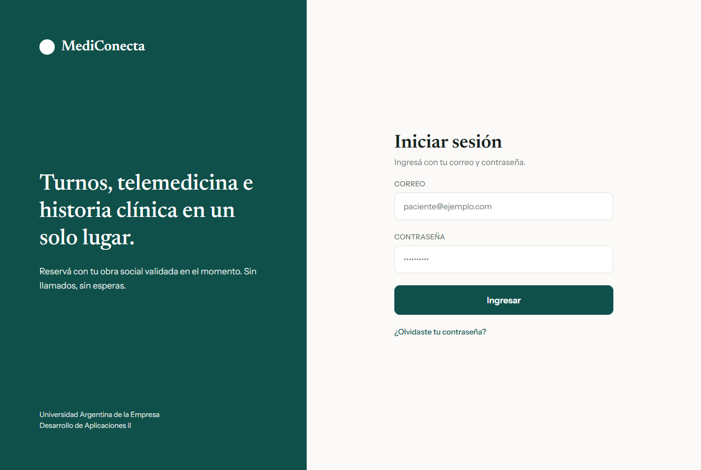
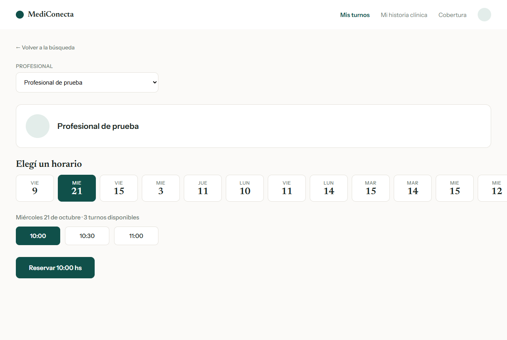
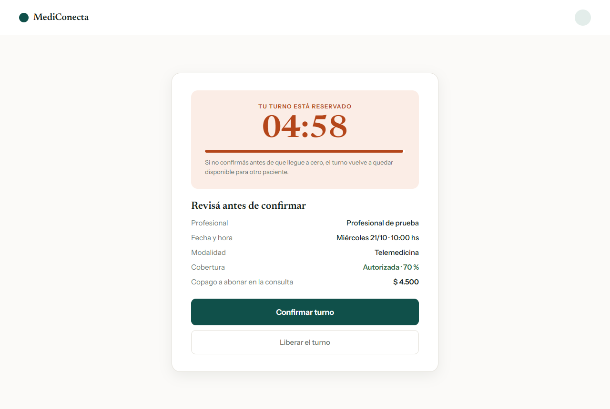
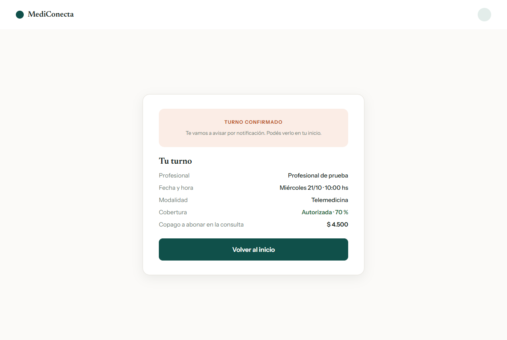
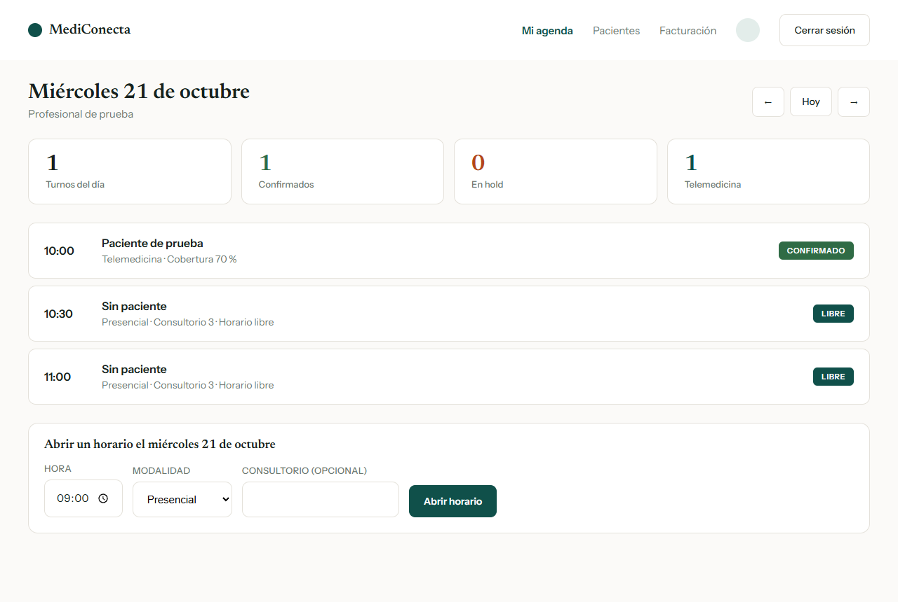
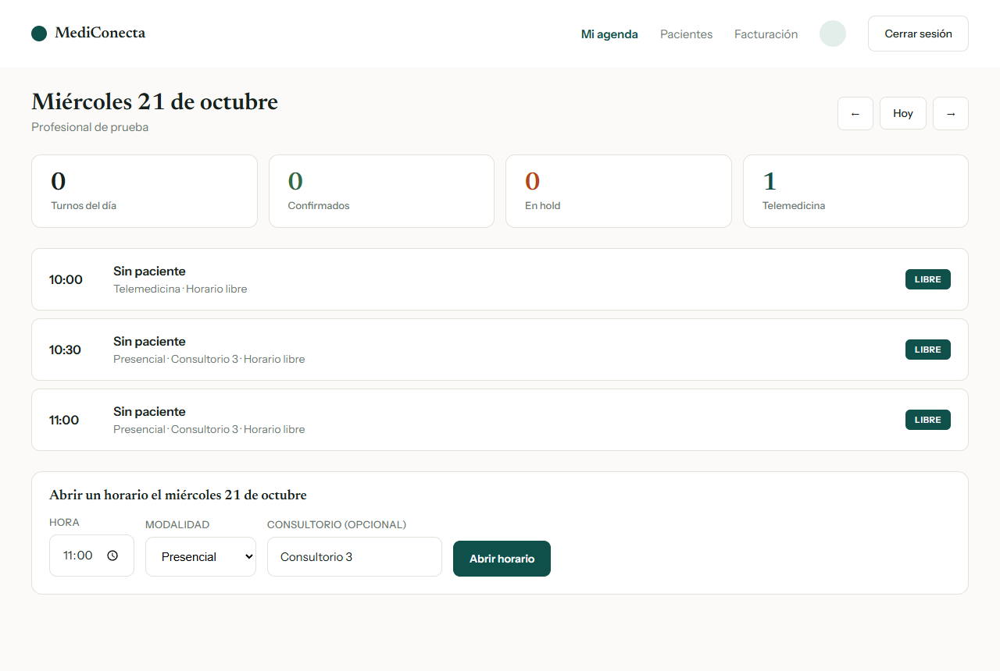
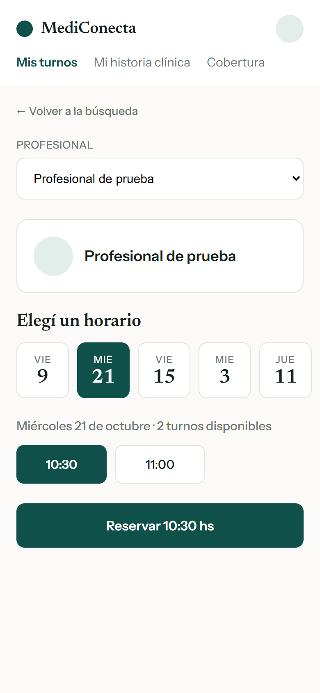

# Manual de usuario de MediConecta

MediConecta es una plataforma para pedir turnos médicos, presenciales o por
telemedicina, con la cobertura de la obra social validada en el momento de
reservar. Este manual explica cómo usar la aplicación desde el navegador.

| Si sos... | Leé |
|---|---|
| Paciente | [1. Ingresar](#1-ingresar) y [2. Reservar un turno](#2-reservar-un-turno-paciente) |
| Profesional | [1. Ingresar](#1-ingresar) y [3. Gestionar la agenda](#3-gestionar-la-agenda-profesional) |
| Cualquiera | [4. Uso desde el celular](#4-uso-desde-el-celular) y [5. Problemas frecuentes](#5-problemas-frecuentes) |

## 1. Ingresar

1. Abrí la dirección de MediConecta en el navegador.
2. Escribí tu **correo** y tu **contraseña**.
3. Tocá **Ingresar**.

La aplicación te lleva a la pantalla que corresponde a tu rol:

- **Paciente:** a *Mis turnos*.
- **Profesional:** a *Mi agenda*.

Si ya tenés la sesión abierta en esa pestaña, MediConecta te lleva directo a
tu pantalla, sin volver a pedirte la contraseña.

> Las cuentas de administración no tienen pantallas en esta versión. Si
> ingresás con una, la aplicación te lo avisa en el mismo formulario.

Para salir, tocá **Cerrar sesión** arriba a la derecha.

## 2. Reservar un turno (paciente)

Reservar un turno tiene dos pasos: primero lo **reservás** y después lo
**confirmás**. Entre los dos tenés cinco minutos.

### 2.1 Elegir profesional, día y horario

1. En *Mis turnos*, tocá **Elegir profesional y horario**.
2. En **Profesional**, elegí con quién querés atenderte.
3. Elegí el **día**. Solo aparecen los días en los que ese profesional tiene
   horarios libres.
4. Elegí el **horario**. El botón de abajo cambia a *Reservar 10:00 hs* (o la
   hora que hayas elegido).
5. Tocá **Reservar**.

Al reservar, MediConecta consulta a tu obra social si cubre la consulta. Por
eso el paso puede tardar unos segundos.

### 2.2 Confirmar dentro de los cinco minutos

Después de reservar vas a ver el turno **retenido a tu nombre**, con una
cuenta regresiva. Mientras corre, nadie más puede tomar ese horario.

Revisá los datos antes de confirmar:

| Dato | Qué significa |
|---|---|
| Profesional, fecha y hora | El turno que elegiste. |
| Modalidad | *Presencial* (con el consultorio, si el profesional lo indicó) o *Telemedicina*. |
| Cobertura | *Autorizada* con el porcentaje que cubre tu obra social, o *Sin cobertura (particular)*. |
| Copago | Lo que te queda por pagar a vos en la consulta. |

Después elegí una opción:

- **Confirmar turno:** el turno queda confirmado y te avisamos por
  notificación.
- **Liberar el turno:** si ya no lo querés, lo devolvés para que otro paciente
  pueda tomarlo y volvés a la elección de horarios.

### 2.3 Si la cuenta regresiva llega a cero

Si no confirmaste a tiempo, la pantalla muestra **La reserva venció** y el
horario vuelve a estar libre para cualquier paciente. Tocá **Elegir otro
turno** para empezar de nuevo.

## 3. Gestionar la agenda (profesional)

*Mi agenda* muestra los turnos de un día. Al ingresar se abre el día de hoy.

### 3.1 Moverse entre días

Con las flechas **←** y **→** pasás al día anterior o al siguiente. **Hoy**
vuelve al día actual.

### 3.2 Leer la agenda

Arriba se resume el día:

| Recuadro | Qué cuenta |
|---|---|
| Turnos del día | Turnos tomados por un paciente (confirmados o en hold). |
| Confirmados | Turnos que el paciente ya confirmó. |
| En hold | Turnos reservados que el paciente todavía no confirmó. |
| Telemedicina | Turnos de telemedicina del día, tomados o libres. |

Cada fila es un horario. A la derecha se ve su estado:

| Estado | Qué significa |
|---|---|
| **LIBRE** | Nadie lo reservó todavía. Aparece como *Sin paciente*. |
| **EN HOLD · 04:12** | Un paciente lo reservó y tiene ese tiempo para confirmarlo. |
| **CONFIRMADO** | El paciente confirmó. Debajo del nombre se ve la modalidad y la cobertura. |
| **CANCELADO** | El turno se canceló. |

### 3.3 Abrir un horario nuevo

Al final de la agenda está el formulario **Abrir un horario**, siempre para el
día que estás viendo.

1. Navegá hasta el día en el que querés atender.
2. Elegí la **hora**.
3. Elegí la **modalidad**: *Presencial* o *Telemedicina*.
4. Si es presencial, podés indicar el **consultorio** (es opcional).
5. Tocá **Abrir horario**.

El horario aparece en la lista como **LIBRE** y desde ese momento los
pacientes lo ven para reservar.

## 4. Uso desde el celular

MediConecta se adapta al tamaño de la pantalla. En el celular las pantallas
son las mismas y los pasos no cambian: los días y horarios se acomodan para
tocarlos con el dedo.

## 5. Problemas frecuentes

| Qué pasa | Por qué | Qué hacer |
|---|---|---|
| El ingreso no funciona | El correo o la contraseña no coinciden. | Revisá los dos datos, incluidas mayúsculas, y volvé a intentar. |
| Al reservar aparece *El turno ya no esta disponible* | Otro paciente reservó ese horario un instante antes. | La lista de horarios se actualiza sola; elegí otro. |
| Al reservar aparece un aviso sobre la obra social | El sistema de tu obra social no respondió en ese momento. | Esperá unos segundos y volvé a reservar. El horario no quedó tomado. |
| La pantalla dice *La reserva venció* | Pasaron los cinco minutos sin confirmar. | Tocá **Elegir otro turno** y reservá de nuevo. |
| Un profesional no tiene días para elegir | Todavía no abrió horarios. | Elegí otro profesional o volvé más tarde. |
