# Manual de usuario de MediConecta

MediConecta es una plataforma para pedir turnos médicos, presenciales o por
teleconsulta, con la cobertura de tu obra social verificada en el momento de
reservar. Este manual explica cómo usarla desde el navegador.

| Si sos... | Leé |
|---|---|
| Paciente | [1. Ingresar](#1-ingresar) y [2. Pacientes](#2-pacientes) |
| Profesional | [1. Ingresar](#1-ingresar) y [3. Profesionales](#3-profesionales) |
| Administrador | [1. Ingresar](#1-ingresar) y [4. Administración](#4-administración) |
| Cualquiera | [5. Preguntas frecuentes](#5-preguntas-frecuentes) |

## 1. Ingresar

1. Abrí la dirección de MediConecta en el navegador.
2. Escribí tu **correo** y tu **contraseña**. El correo se puede escribir con
   mayúsculas o minúsculas.
3. Tocá **Ingresar**.

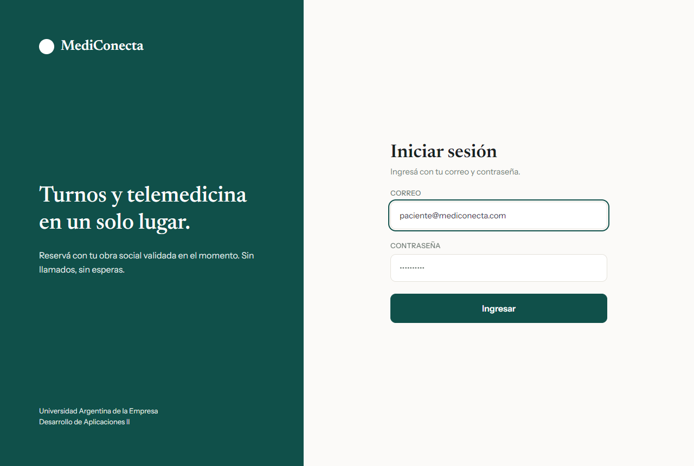

MediConecta te lleva a la pantalla de tu rol:

- **Paciente:** a *Mis turnos*.
- **Profesional:** a *Mi agenda*.
- **Administrador:** a *Reclamos a obras sociales*.

Para salir, tocá **Cerrar sesión**, arriba a la derecha. La sesión vale solo
para la pestaña en la que ingresaste.

## 2. Pacientes

Pedir un turno tiene dos pasos: primero lo **reservás** y después lo
**confirmás** pagando el copago. Entre los dos tenés cinco minutos.

### 2.1 Reservar: elegir profesional y horario

1. En *Mis turnos*, tocá **Elegir profesional y horario** (o **Reservar un
   turno** si todavía no tenés ninguno).
2. En **Profesional**, elegí con quién querés atenderte.
3. Elegí el **día**. Solo aparecen los días en los que ese profesional tiene
   horarios libres.
4. Elegí el **horario**. Cada horario indica si es *Presencial* o
   *Telemedicina*.
5. Tocá **Reservar** (el botón muestra la hora elegida).

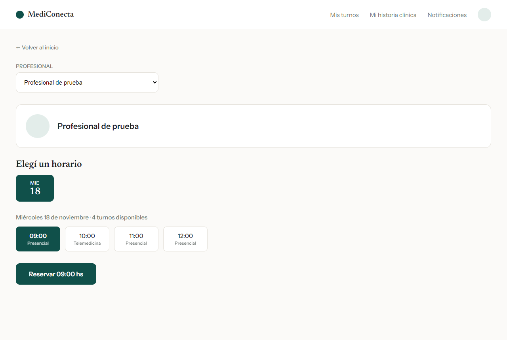

Al reservar, MediConecta consulta a tu obra social cuánto cubre. Por eso este
paso puede tardar unos segundos.

### 2.2 Confirmar dentro de los cinco minutos

Después de reservar, el turno queda **guardado a tu nombre** y aparece una
cuenta regresiva. Mientras corre, nadie más puede tomar ese horario.

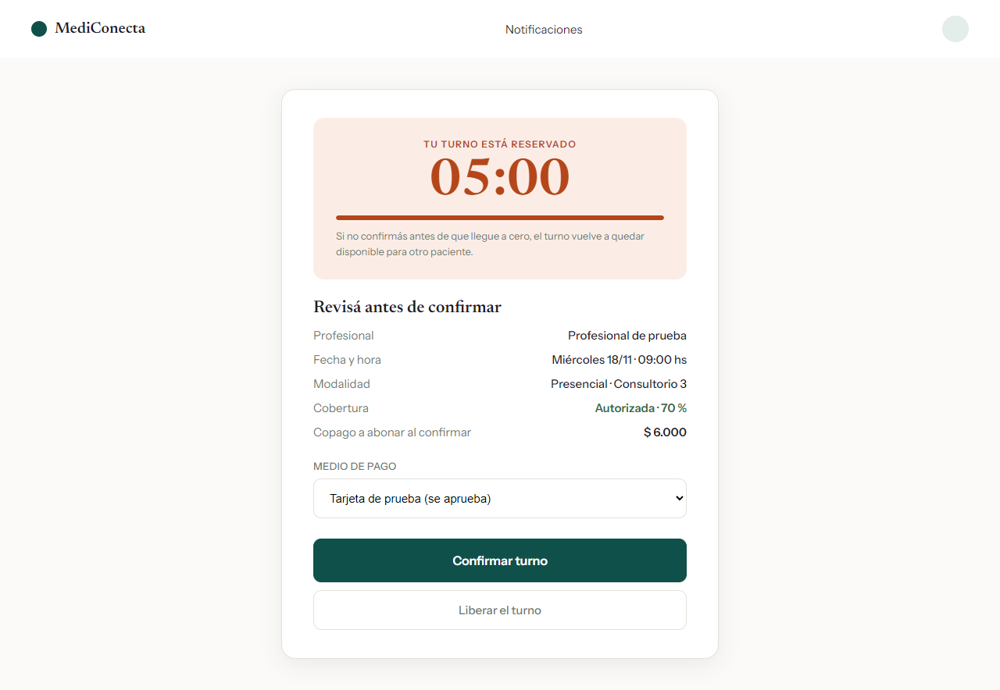

Revisá los datos antes de confirmar:

| Dato | Qué significa |
|---|---|
| Profesional, fecha y hora | El turno que elegiste. |
| Modalidad | *Presencial* (con el consultorio, si el profesional lo indicó) o *Telemedicina*. |
| Cobertura | *Autorizada* con el porcentaje que cubre tu obra social, o *Sin cobertura (particular)*. |
| Copago | Lo que pagás vos al confirmar. |

Si hay copago, elegí el **medio de pago**. En esta versión de demostración hay
tarjetas de prueba: *Tarjeta de prueba (se aprueba)* viene elegida, y las otras
opciones sirven para ver qué pasa cuando el pago se rechaza o no se puede
procesar.

Después elegí:

- **Confirmar turno:** se cobra el copago y el turno queda confirmado.
- **Liberar el turno:** si ya no lo querés, lo devolvés para que otro paciente
  pueda tomarlo y volvés a la elección de horarios.

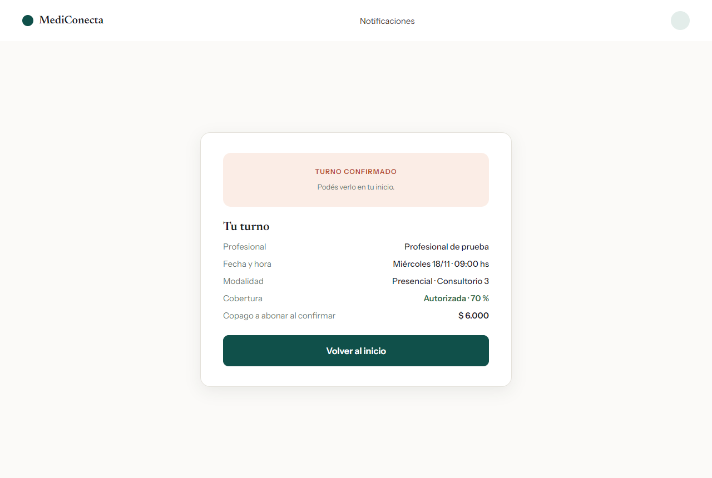

### 2.3 Mis turnos

*Mis turnos* es tu pantalla de inicio. Muestra:

- **Tu reserva pendiente**, si tenés una sin confirmar, con la hora en la que
  vence y el botón **Retomar la reserva** para volver a confirmarla.
- **Tus turnos confirmados**, con el profesional, el lugar, la hora y la
  cobertura.

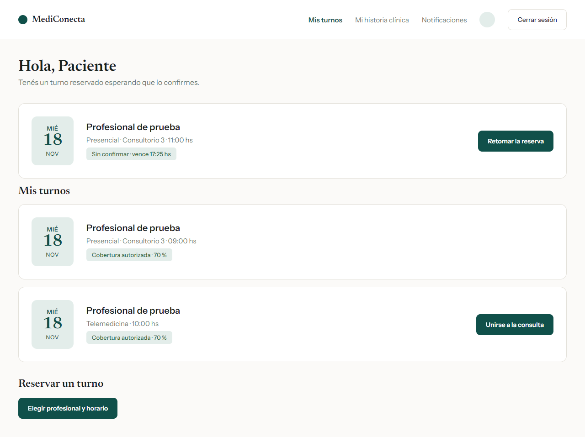

### 2.4 Unirse a una teleconsulta

Cuando confirmás un turno de *Telemedicina*, MediConecta prepara la sala de
video. Aparece el botón **Unirse a la consulta** al confirmar y en la tarjeta
del turno en *Mis turnos*. Al tocarlo, la consulta se abre en otra pestaña.

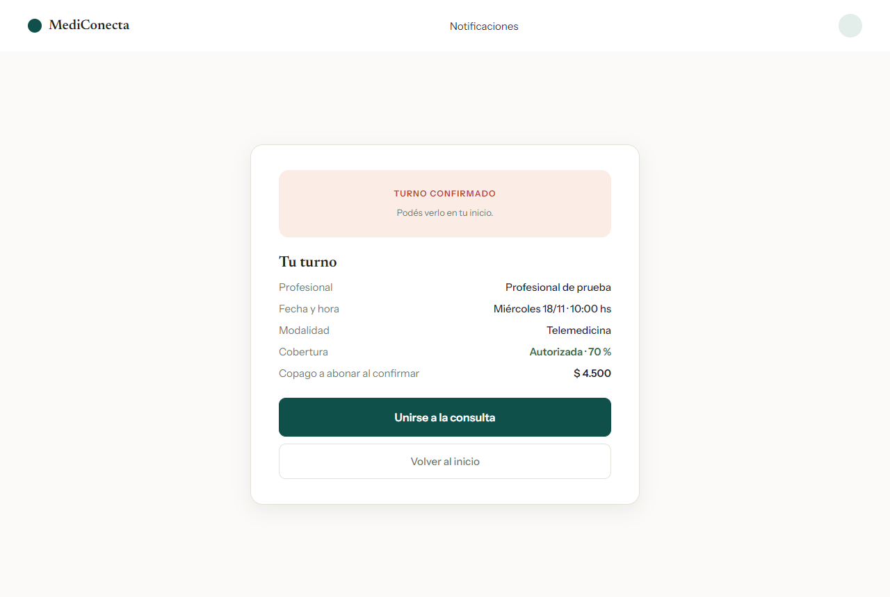

### 2.5 Notificaciones

En **Notificaciones**, en el menú de arriba, ves los avisos de MediConecta,
del más reciente al más antiguo. Cada vez que confirmás un turno recibís uno
con la fecha y la hora. Puede tardar unos segundos en aparecer.

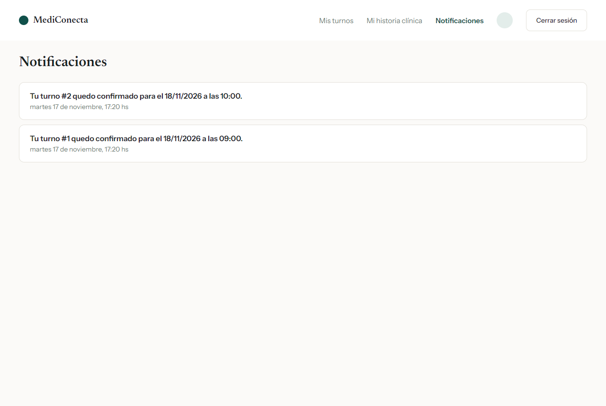

### 2.6 Mi historia clínica

En **Mi historia clínica** ves lo que tus profesionales registraron:
diagnósticos y recetas, del más reciente al más antiguo. Solo vos y tus
profesionales pueden verla. Si todavía no tenés historia, se abre en tu
primera consulta.

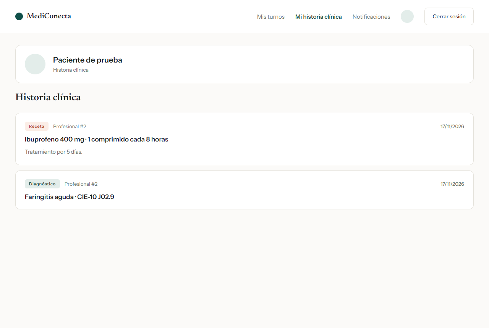

### 2.7 Cancelar

Una reserva pendiente se cancela con **Liberar el turno**, desde la pantalla
de confirmación (en *Mis turnos*, tocá **Retomar la reserva** para llegar a
ella). El horario vuelve a quedar libre en el momento.

Si no hacés nada, la reserva se cancela sola a los cinco minutos.

Esta versión no permite cancelar desde la aplicación un turno ya confirmado.

## 3. Profesionales

### 3.1 Mi agenda

*Mi agenda* muestra los turnos de un día. Al ingresar se abre el día de hoy.
Con las flechas pasás al día anterior o al siguiente, **Hoy** vuelve al día
actual y el calendario te lleva a cualquier fecha. La agenda se actualiza sola
cada pocos segundos: no hace falta recargarla.

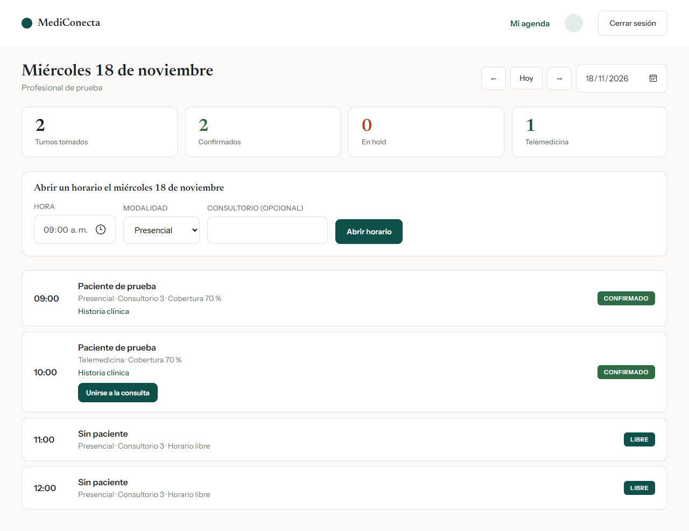

Arriba se resume el día (turnos tomados, confirmados, pendientes de confirmar
y de telemedicina). Cada fila es un horario, con su estado a la derecha:

| Estado | Qué significa |
|---|---|
| **LIBRE** | Nadie lo reservó todavía. |
| **EN HOLD** | Un paciente lo reservó y todavía tiene tiempo para confirmarlo. |
| **CONFIRMADO** | El paciente confirmó. Debajo del nombre se ven la modalidad y la cobertura. |
| **CANCELADO** | El turno se canceló. |

En un turno de telemedicina confirmado aparece **Unirse a la consulta**, para
entrar a la sala de video como profesional.

### 3.2 Abrir horarios

El formulario **Abrir un horario** está en la agenda, para el día que estás
viendo (no aparece en días pasados).

1. Navegá hasta el día en el que querés atender.
2. Elegí la **hora**.
3. Elegí la **modalidad**: *Presencial* o *Telemedicina*.
4. Si es presencial, podés indicar el **consultorio** (es opcional).
5. Tocá **Abrir horario**.

El horario aparece como **LIBRE** y desde ese momento los pacientes pueden
reservarlo. Si ya tenías un horario abierto a esa hora, la agenda te lo avisa.

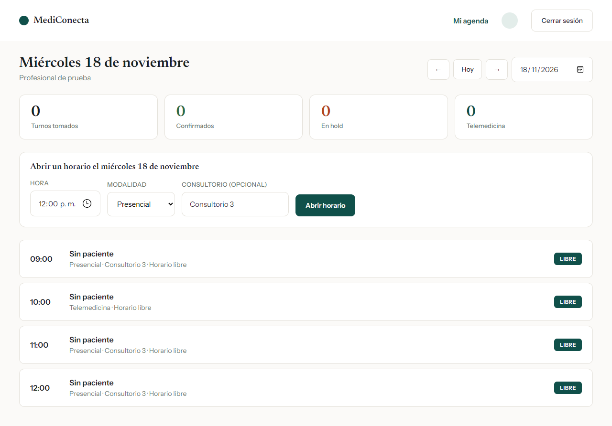

### 3.3 Historia clínica del paciente

Cada turno con paciente tiene el enlace **Historia clínica**. Tocalo para ver
la historia de ese paciente.

Si el paciente todavía no tiene historia, tocá **Abrir historia clínica**.

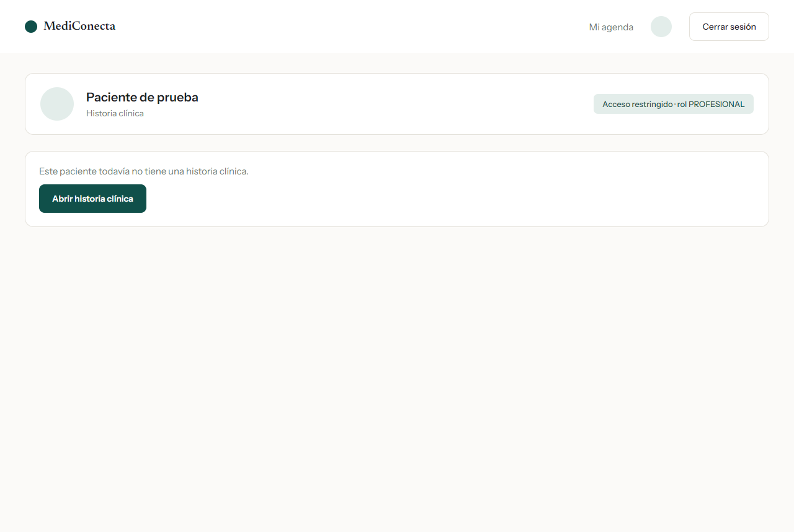

### 3.4 Registrar una consulta

Con la historia abierta, completá **Registrar consulta**:

1. El **código CIE-10** y el **diagnóstico**.
2. Si indicás medicación, tocá **Agregar receta** y completá el
   **medicamento**, la **dosis** y los **días** de tratamiento. Podés agregar
   varias recetas o quitarlas.
3. Tocá **Registrar consulta**.

Aparece *Consulta registrada.* y las entradas nuevas se suman a la historia,
que el paciente ve desde *Mi historia clínica*. Si falta un dato obligatorio, el
formulario te dice cuál.

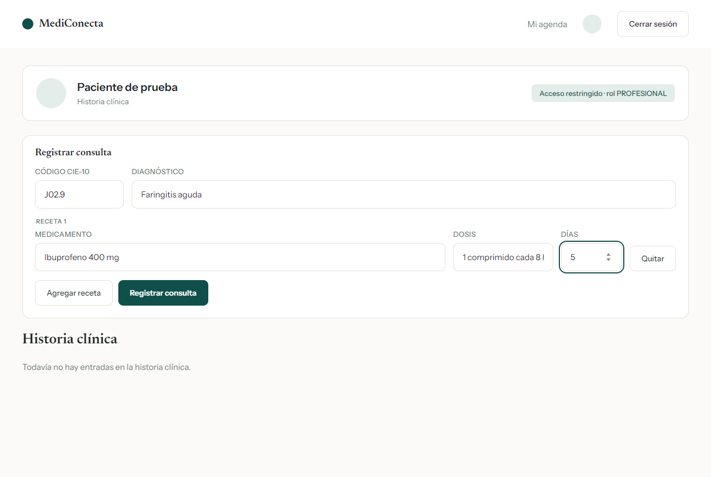

## 4. Administración

### 4.1 Reclamos a obras sociales

Cuando un paciente con obra social confirma un turno, MediConecta le presenta
el reclamo a su obra social. En *Reclamos a obras sociales* ves cada uno, con
el turno, el monto que reconoce la obra social, los intentos, la fecha de la
última actualización y el número de presentación.

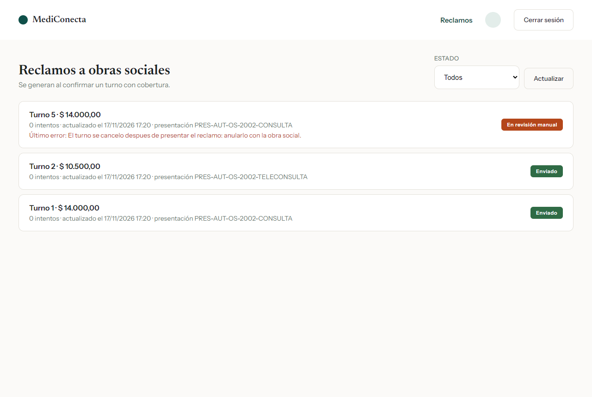

| Estado | Qué significa |
|---|---|
| **Enviado** | La obra social recibió el reclamo. |
| **Pendiente de envío** | Todavía no se pudo presentar; MediConecta lo reintenta solo. |
| **En revisión manual** | Hace falta revisarlo a mano, por ejemplo porque el turno se canceló después de presentarlo. Debajo se ve el motivo. |
| **Anulado** | El turno se canceló antes de presentarlo. |

### 4.2 Filtrar por estado

En **Estado**, elegí uno para ver solo esos reclamos, o *Todos*. **Actualizar**
vuelve a cargar la lista. Si hay muchos, se reparten en páginas.

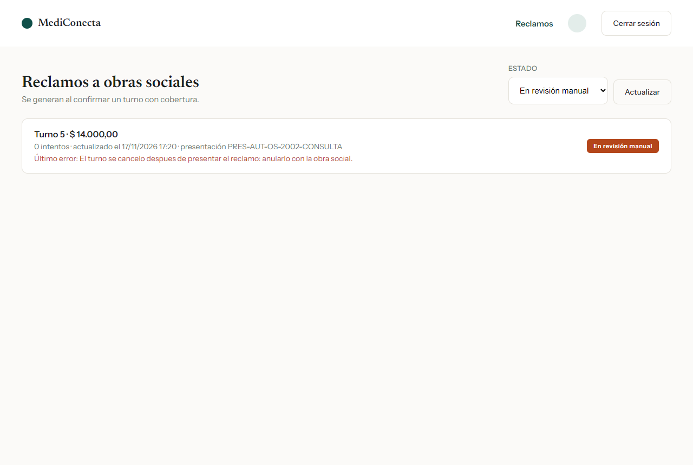

## 5. Preguntas frecuentes

**¿Qué pasa si no confirmo en cinco minutos?**
La reserva vence: la pantalla muestra *La reserva venció*, el horario vuelve a
quedar libre para cualquier paciente y no se cobra nada. Tocá **Elegir otro
turno** para empezar de nuevo.

**¿Por qué no puedo reservar otro turno?**
Podés tener una sola reserva pendiente a la vez. Si ya tenés una sin
confirmar, aparece *Ya tenés otro turno reservado sin confirmar*. Confirmala o
liberala desde **Retomar la reserva** en *Mis turnos*, o esperá a que venza.

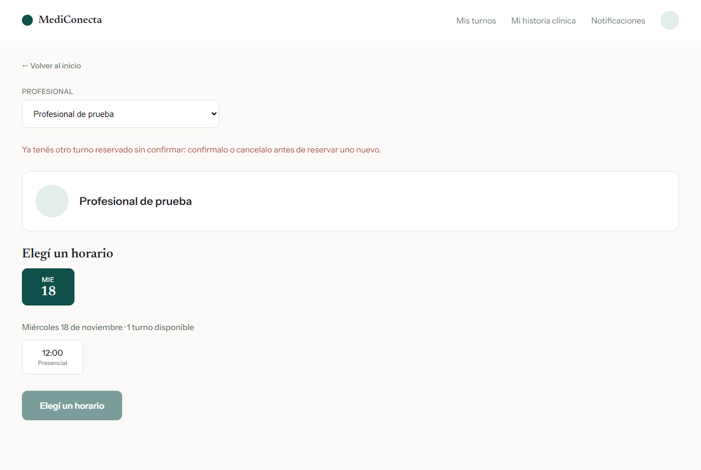

**¿Qué pasa si la obra social no responde?**
Al reservar aparece *El sistema de la obra social no respondió. Intentá de
nuevo en unos minutos.* El horario no queda tomado: volvé a intentar más
tarde. Si la obra social no responde después de que confirmaste, tu turno
sigue confirmado igual y el reclamo se reintenta solo.

**¿Y si el pago falla?**
Si la tarjeta se rechaza o el pago no se puede procesar, aparece un aviso y el
turno sigue reservado a tu nombre, sin cobrarte nada. Probá de nuevo o con
otro medio de pago antes de que termine la cuenta regresiva. Si se cobró y
algo falló después, el cobro se devuelve solo.

**¿Por qué no puedo ingresar?**
Revisá el correo y la contraseña. Después de varios intentos fallidos
seguidos, el ingreso queda bloqueado unos minutos por seguridad.

**¿Puedo usarlo desde el celular?**
Sí. Las pantallas se adaptan al tamaño de la pantalla y los pasos son los
mismos.

**Un profesional no tiene días para elegir.**
Todavía no abrió horarios. Elegí otro profesional o volvé más tarde.
